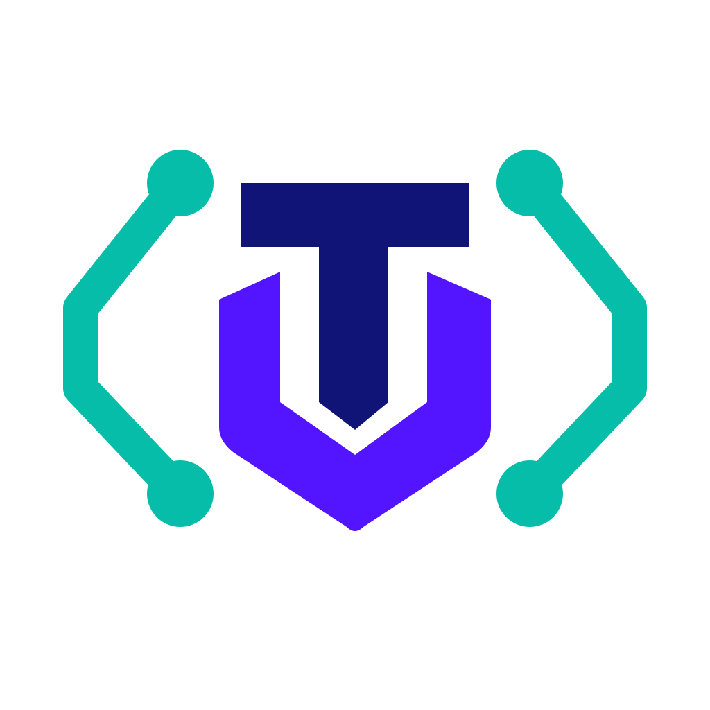
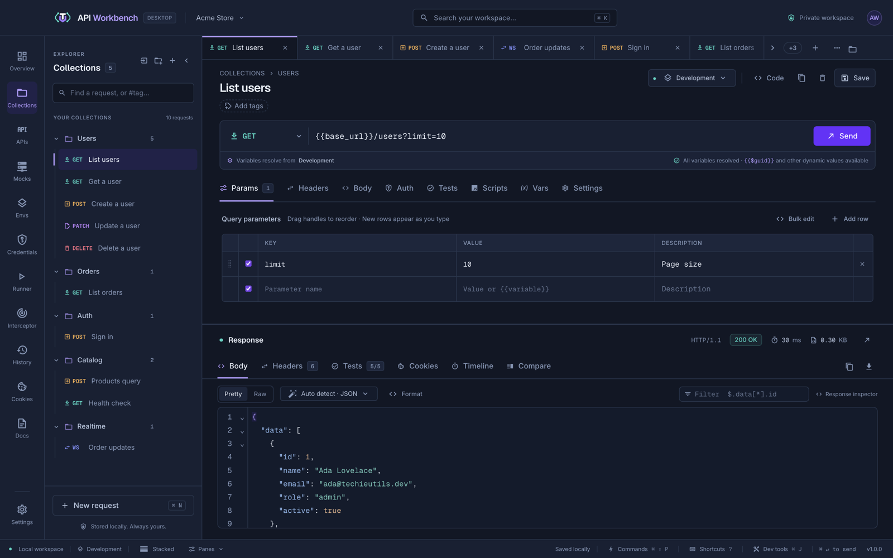

<p align="center">
  
</p>

<h1 align="center">API Workbench</h1>

<p align="center">
  <strong>Build, test, debug, and automate APIs — all in one place.</strong><br>
  An open-source, local-first desktop API client for HTTP, GraphQL, WebSocket, SSE, NDJSON, gRPC, Socket.IO, and MQTT.
</p>

<p align="center">
  <a href="https://techieutils.github.io/api-workbench/">Website</a> ·
  <a href="https://techieutils.github.io/api-workbench/docs/getting-started.html">Getting started</a> ·
  <a href="docs/README.md">Documentation</a> ·
  <a href="https://github.com/techieutils/api-workbench/releases">Download</a> ·
  <a href="docs/changelog.md">Changelog</a> ·
  <a href="CONTRIBUTING.md">Contributing</a>
</p>

<p align="center">
  <a href="LICENSE"></a>
  <a href="https://github.com/techieutils/api-workbench/actions/workflows/ci.yml"></a>
  
  
  <a href="SECURITY.md"></a>
</p>



## Contents

- [Why API Workbench](#why-api-workbench)
- [Features](#features)
- [Quick start](#quick-start)
- [Platforms and packages](#platforms-and-packages)
- [Security and privacy](#security-and-privacy)
- [Development](#development)
- [Support](#support)
- [Contributing](#contributing)
- [License](#license)

## Why API Workbench

- **Local first.** No account, no cloud sync, no telemetry. Workspaces, history, and secrets stay on your machine, in files you control.
- **Secrets done properly.** An encrypted credential vault backed by macOS Keychain, Windows DPAPI, or the Linux Secret Service; cloud secret providers; and client certificates — never stored as plain text.
- **More than requests.** Tests on every send, values captured from any part of a response to chain requests, collection runs, benchmarks and load tests with real percentiles, real-time protocols, and a capture proxy for other apps' traffic.
- **Open.** MIT licensed, with collections importable from — and exportable to — the tools you already use.

## Features

|                         |                                                                                                                                                                                                                                                                                                                                                                                           |
| ----------------------- | ----------------------------------------------------------------------------------------------------------------------------------------------------------------------------------------------------------------------------------------------------------------------------------------------------------------------------------------------------------------------------------------- |
| **Requests**            | HTTP and GraphQL with params, headers, JSON, XML, form, multipart, and binary bodies; environments and `{{variables}}`; body integrity headers (Content-Digest, S3 checksums, or your own header with CRC, SHA, MD5, or xxHash); code generation in 26 languages                                                                                                                          |
| **Responses**           | Pretty and raw views, rendered HTML and Markdown, hex and Base64 views, JSON path filtering with wildcards and filters, a network timing waterfall, TLS certificate details, and response comparison                                                                                                                                                                                      |
| **Testing**             | Plain-text or visual assertions on status, timing, headers, and bodies: text, pattern, and case-insensitive comparisons, ranges, value lists, JSON paths, and JSON Schema                                                                                                                                                                                                                 |
| **Scripts**             | Pre-request and post-response JavaScript at the request, folder, collection, and workspace levels, with a shared library and snippets; the editor suggests the `aw` API and the last response's fields as you type and underlines syntax errors; scripts run sandboxed in QuickJS                                                                                                         |
| **Captures**            | Save values into variables from JSON paths, headers, cookies, patterns, HTML elements, form fields, timings, certificates, or a failure — with transforms like `first`, `join`, `jwt`, and `default` — and right-click any response view to capture from it                                                                                                                               |
| **History**             | Every send with its response, headers, cookies, timing, certificate, tests, console, and a comparison with earlier responses — each one ready to capture from                                                                                                                                                                                                                             |
| **Performance**         | API benchmarks and duration-based load tests with p50–p99.9, confidence intervals, charts, baselines, and JSON/CSV reports                                                                                                                                                                                                                                                                |
| **Team workspaces**     | Share a workspace through a shared folder or a GitHub, GitLab, or Bitbucket repository, with clone, commit, pull, push, and conflict choices in the app; secrets stay on each device                                                                                                                                                                                                      |
| **Command line and CI** | The `api-workbench` command runs collections, data-driven runs, and load tests in CI with JUnit and JSON reports; sends requests, with file uploads and client certificates; and manages workspaces, collections, environments, credentials, certificates, specifications, mock servers, and Git sync from a terminal. Install it from npm (GitHub Packages) or download one file         |
| **VS Code**             | The extension browses, edits, sends, and runs a workspace's requests from the editor — every auth type, GraphQL, file uploads, live connections, mock servers, environments, credentials, client certificates, network timing, and the Testing view — sends `.http` files with their uploads and a workspace's environment, and gives Copilot agent mode tools that ask before every send |
| **Real time**           | WebSocket, Server-Sent Events, NDJSON streams, gRPC (unary and every streaming kind), Socket.IO events with acknowledgements, and MQTT 3.1.1/5 publish and subscribe                                                                                                                                                                                                                      |
| **API specs and mocks** | OpenAPI and Swagger editing with live validation, collections and mocks generated from specs, and local mock servers (HTTP, WebSocket, SSE, NDJSON, gRPC, Socket.IO, and MQTT) with rules, Faker-style templates, CORS, security headers, and HTTPS                                                                                                                                       |
| **Dev tools**           | A console, network log, performance summary, and a real terminal with tabs and split panes                                                                                                                                                                                                                                                                                                |
| **Interceptor**         | A capture proxy that records browser, simulator, and CLI traffic, including decrypted HTTPS, and saves it as requests                                                                                                                                                                                                                                                                     |
| **Authentication**      | Bearer, Basic, API key, Digest, NTLM, WSSE, AWS Signature, Akamai EdgeGrid, Hawk, JWT, OAuth 1.0, and OAuth 2.0 with discovery from `/.well-known` metadata                                                                                                                                                                                                                               |
| **Import and export**   | Postman, Bruno, Insomnia, Hoppscotch (import), OpenCollection, OpenAPI/Swagger, WSDL, HAR, cURL, and `.http` files (with `< ./file` uploads and multipart forms), from files or links (gists, GitHub, GitLab, Bitbucket); share exports as a file, on the clipboard, or as a GitHub gist                                                                                                  |

See the [documentation](docs/README.md) for guides with screenshots, or the [technical reference](docs/reference.md) for every detail.

## Quick start

1. [Download](https://github.com/techieutils/api-workbench/releases) and install API Workbench for your platform.
2. Open it, and send the sample request in **Getting started**.
3. Add an environment and a `{{base_url}}` variable, then a test such as `status 200`.
4. Follow [Getting started](docs/getting-started.md) for the rest, or [Migrate from Postman](docs/guides/migrate-from-postman.md) to bring your collections.

For CI, install the command line, which runs the same collections from a terminal:

```sh
npm install --global @techieutils/api-workbench-cli   # from GitHub Packages; needs a token, see below
api-workbench run ./api -e Staging --report-junit results.xml
```

Its [README](packages/api-workbench-cli/README.md) explains every command and the one-time npm setup, and [Command line](docs/cli.md) has the details.

To work from VS Code, download `api-workbench-vscode-<version>.vsix` from a [release](https://github.com/techieutils/api-workbench/releases) and install it with **Extensions → … → Install from VSIX…**, or from a terminal:

```sh
code --install-extension api-workbench-vscode-1.0.0.vsix
```

It needs VS Code 1.145 or later and nothing else: the command line is inside it. See [VS Code extension](docs/vscode.md).

## Platforms and packages

| Platform | Packages                                      | Architectures                      |
| -------- | --------------------------------------------- | ---------------------------------- |
| macOS    | `.dmg`, `.pkg` installer, and `.zip`          | Apple silicon (arm64), Intel (x64) |
| Windows  | Installer (NSIS), portable `.exe`, and `.zip` | x64, arm64                         |
| Linux    | AppImage, `.deb`, `.rpm`, and `.tar.gz`       | x86_64, arm64                      |
| VS Code  | `.vsix` extension, 1.145 or later             | Wherever VS Code runs              |

The command line runs anywhere Node.js 22.19 or later does, as the npm package [`@techieutils/api-workbench-cli`](packages/api-workbench-cli/README.md) on GitHub Packages, or as one file, `api-workbench-cli.cjs`, attached to every release. GitHub's npm registry asks for a token with `read:packages`, even for public packages; the single file needs none.

Installed copies keep themselves up to date from GitHub releases, asking before they download a new version; see [Updates](docs/updates.md).

API Workbench runs on Electron 45, so it supports the operating system versions Electron 45 supports. On Linux, the credential vault needs a running keyring service such as GNOME Keyring or KWallet. See [Installation](docs/installation.md) for details.

## Security and privacy

- Secrets are encrypted with the operating system's own store and never leave the Electron main process; the interface only sees metadata.
- The interface runs sandboxed, with context isolation and a strict content security policy; response previews never run scripts.
- Responses kept in History are saved to disk only while **Persist response bodies** is on.
- Nothing is sent anywhere except the requests you make and a check of GitHub releases for new versions, which carries no workspace data and can be turned off in **Settings → Updates**. There is no account, analytics, or telemetry.
- Updates are verified against each release's SHA-512 checksum before they install.
- The VS Code extension runs only in workspaces you trust, never shows a secret, and asks before running a workspace's scripts; a workspace's own settings cannot choose what it runs.

Report vulnerabilities privately as described in the [security policy](SECURITY.md) — never in a public issue.

## Development

To build from source you need **Node.js 22.19 or later** (24 is recommended — it is what Electron 45 runs, and `.nvmrc` names it) and npm. On Linux, install the usual Electron build tools for your distribution.

```sh
git clone https://github.com/techieutils/api-workbench.git
cd api-workbench
npm install
npm start          # run the desktop app
npm run dist       # build an installer for this platform in release/
```

| Command                                          | What it does                                                                         |
| ------------------------------------------------ | ------------------------------------------------------------------------------------ |
| `npm start`                                      | Compile and launch the desktop app                                                   |
| `npm run check`                                  | Type-check the main process, shared code, and Vue renderer                           |
| `npm run lint` / `npm run format:check`          | ESLint with zero warnings, and Prettier formatting (`npm run format` fixes it)       |
| `npm test`                                       | Application tests in `tests/`, every package's `*.spec.ts` specs, and the Vue tests  |
| `npm run test:vue`                               | Only the Vue component and store tests (Vitest)                                      |
| `npm run test:e2e`                               | Playwright end-to-end tests: clicks and types in the compiled desktop app (`e2e/`)   |
| `npm run test:ui` / `npm run test:ui:protocols`  | Drive the real Electron app with disposable data; add `-- --only=11` to run one part |
| `npm run cli -- <command>`                       | Run the command line from source; `npm run cli:package` builds its npm package       |
| `npm run vscode:package` / `npm run test:vscode` | Build the VS Code extension's `.vsix`; test it inside an installed VS Code           |
| `npm run docs:screenshots`                       | Recapture the documentation screenshots                                              |
| `npm run site:build` / `npm run site:preview`    | Build and preview the GitHub Pages site                                              |

The repository is a set of npm workspaces — the desktop app's main process and interface, shared code, the command line, and the VS Code extension; [CONTRIBUTING.md](CONTRIBUTING.md#how-the-code-is-organised) says what each holds.

Every pull request runs lint, formatting, type-checks, and tests in [CI](.github/workflows/ci.yml). [CONTRIBUTING.md](CONTRIBUTING.md) explains the layout, conventions, and how to submit a change.

## Support

| You want to…           | Go to                                                                                                                                                |
| ---------------------- | ---------------------------------------------------------------------------------------------------------------------------------------------------- |
| Learn a feature        | The [documentation](https://techieutils.github.io/api-workbench/docs/index.html), [FAQ](docs/faq.md), and [troubleshooting](docs/troubleshooting.md) |
| Report a bug           | A [bug report](https://github.com/techieutils/api-workbench/issues/new?template=bug_report.yml)                                                      |
| Suggest a feature      | A [feature request](https://github.com/techieutils/api-workbench/issues/new?template=feature_request.yml)                                            |
| Report a vulnerability | The private process in the [security policy](SECURITY.md)                                                                                            |
| See what changed       | The [changelog](docs/changelog.md) and [releases](https://github.com/techieutils/api-workbench/releases)                                             |

API Workbench is maintained by volunteers; support is best effort through GitHub.

## Contributing

Contributions are welcome — bug reports, fixes, features, and documentation. Please read the [contributing guide](CONTRIBUTING.md) and follow the [code of conduct](CODE_OF_CONDUCT.md).

## License

API Workbench is released under the [MIT License](LICENSE). Copyright © 2026 techieutils and API Workbench contributors.

Bundled third-party components keep their own licenses: fonts from Fontsource (SIL Open Font License), Material Design Icons (Apache 2.0), CodeMirror (MIT), and the npm dependencies listed in each package's `package.json`. The command line's npm package lists the licenses of everything bundled into it in `api-workbench.cjs.LEGAL.txt`.
