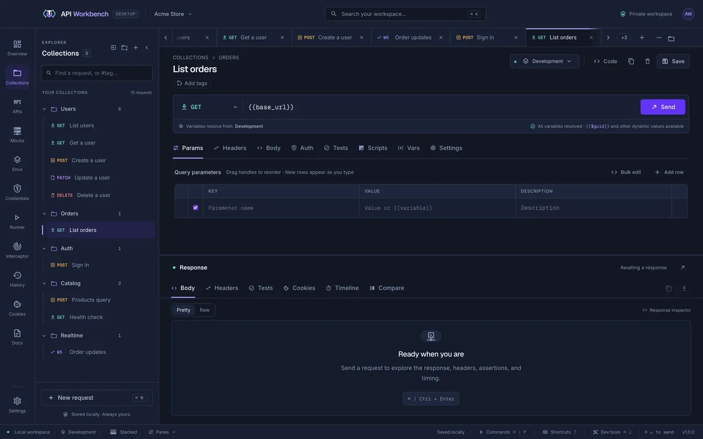

# API Workbench documentation



## Start here

New to API Workbench? Install it, send your first request, and learn your way around the window.

```cards
- title: Quick start
  icon: rocket-launch-outline
  href: getting-started.md
  text: Send your first request, add a variable and a test in five minutes.
- title: Installation
  icon: download
  href: installation.md
  text: Download an installer for macOS, Windows, or Linux, or build from source.
- title: The interface
  icon: view-dashboard-outline
  href: interface.md
  text: A tour of the window, the explorer, tabs, and panels.
```

## Browse by protocol

```chips
- title: REST and HTTP
  icon: web
  href: rest-graphql.md
- title: GraphQL
  icon: graphql
  href: rest-graphql.md
- title: WebSocket
  icon: swap-horizontal
  href: websocket.md
- title: Server-Sent Events
  icon: broadcast
  href: sse.md
- title: NDJSON streams
  icon: format-list-text
  href: ndjson.md
- title: gRPC
  icon: lan
  href: grpc.md
- title: Socket.IO
  icon: lightning-bolt-outline
  href: socketio.md
- title: MQTT
  icon: access-point-network
  href: mqtt.md
```

## Explore the features

Everything you need to take an API from the first request to a load test, without an account or the cloud.

```cards
- title: Requests and responses
  icon: send-outline
  href: requests.md
  text: Params, headers, bodies, auth, previews, and a network waterfall.
- title: Tests
  icon: check-circle-outline
  href: tests.md
  text: Assertions on every send — text and pattern checks, ranges, JSON paths, and JSON Schema.
- title: Environments and variables
  icon: variable
  href: variables.md
  text: Switch targets, generate dynamic values, and chain requests with values captured from any response.
- title: API specifications
  icon: api
  href: api-specs.md
  text: Write OpenAPI with live validation, then generate collections and mocks.
- title: Mock servers
  icon: server-network
  href: mock-servers.md
  text: Serve canned responses on localhost from routes, collections, or specs.
- title: Runner and performance
  icon: speedometer
  href: runner.md
  text: Collection runs, benchmarks, and load tests with percentiles and charts.
- title: Command line
  icon: console
  href: cli.md
  text: Run tests and load tests in CI, send requests, and manage workspaces from a terminal.
- title: VS Code extension
  icon: microsoft-visual-studio-code
  href: vscode.md
  text: Edit, send, and run requests, .http files, and mocks from the editor.
- title: Interceptor
  icon: radar
  href: interceptor.md
  text: Capture traffic from browsers, simulators, and CLIs — including HTTPS.
- title: Credential vault
  icon: shield-lock-outline
  href: credentials.md
  text: Secrets encrypted by your operating system, and cloud secret stores.
- title: Dev tools
  icon: tools
  href: dev-tools.md
  text: Console, network log, performance summary, and a real terminal with splits.
```

## Switch from another tool

Bring your collections, environments, and auth with you. Every import is previewed before anything changes.

```cards compact
- title: Postman
  icon: swap-vertical
  href: guides/migrate-from-postman.md
- title: Insomnia
  icon: weather-night
  href: guides/migrate-from-insomnia.md
- title: Bruno
  icon: dog
  href: guides/migrate-from-bruno.md
- title: Hoppscotch
  icon: web
  href: guides/migrate-from-hoppscotch.md
- title: More tools
  icon: toolbox-outline
  href: guides/migrate-from-other-tools.md
```

## Popular topics

```links
- title: Guides
  icon: compass-outline
  links:
    - title: Test a REST API end to end
      href: guides/test-a-rest-api.md
    - title: Chain requests with captured variables
      href: guides/chain-requests.md
    - title: Load test an API
      href: guides/load-test-an-api.md
    - title: Connect to an OAuth 2.0 API
      href: guides/oauth-with-discovery.md
- title: Configure
  icon: tune-variant
  links:
    - title: Authorization
      href: authentication.md
    - title: Client certificates
      href: client-certificates.md
    - title: Proxies and HTTP settings
      href: settings.md
    - title: Updates
      href: updates.md
    - title: Import and export
      href: import-export.md
- title: Reference
  icon: book-open-page-variant-outline
  links:
    - title: Keyboard shortcuts
      href: shortcuts.md
    - title: Code snippets
      href: code-snippets.md
    - title: API documentation
      href: api-documentation.md
    - title: Technical reference
      href: reference.md
```

> [!TIP]
> Press <kbd>?</kbd> in the app for every keyboard shortcut, and <kbd>⌘/Ctrl</kbd>+<kbd>Shift</kbd>+<kbd>P</kbd> for the command palette.

## Get help

```cards compact
- title: Support
  icon: lifebuoy
  href: support.md
- title: FAQ
  icon: frequently-asked-questions
  href: faq.md
- title: Troubleshooting
  icon: wrench-outline
  href: troubleshooting.md
- title: Report a bug
  icon: bug-outline
  href: https://github.com/techieutils/api-workbench/issues/new?template=bug_report.yml
- title: Contribute
  icon: source-pull
  href: ../CONTRIBUTING.md
```
