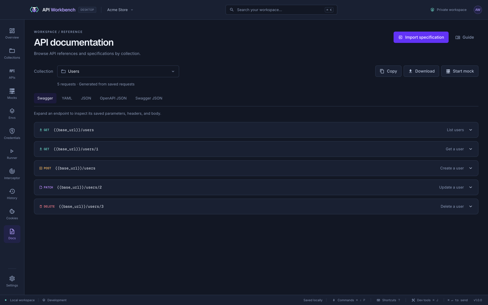
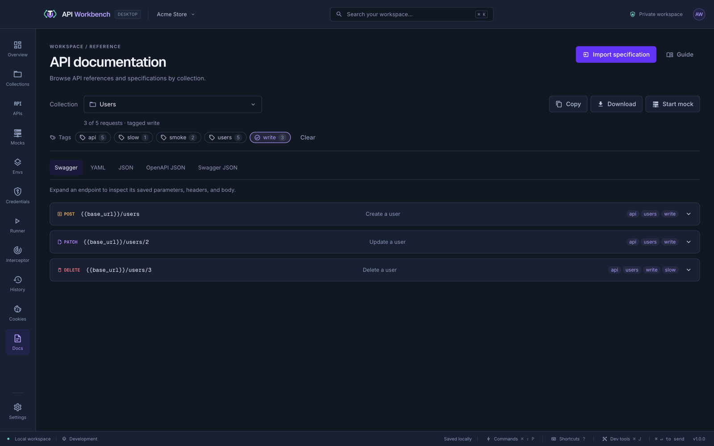

# API documentation

**Docs** turns a collection into a reference: pick it from **Collection** (each with its request count) and expand an endpoint to see its parameters, headers, authentication, and example body, with a link to open the request.

The tabs show the same collection as **YAML** (OpenAPI), **JSON** (API Workbench), **OpenAPI JSON** 3.0.3, and **Swagger JSON** 2.0. **Format** (also in the source's right-click menu) tidies the shown source with the same formatter as the editors; **Copy** or **Download** the one you need, as shown. Variables stay as `{{name}}`, and credential fields and secrets in example bodies are redacted.

## Document part of a collection by tag

When the collection's requests have [tags](requests.md#tags) — their own, or their collection's and folders' — the **Tags** bar lists them, each with how many requests have it. Click a tag to document only requests with it, again to leave them out instead, and again to stop; **Any tag** and **All tags** choose how several combine, and **Clear** removes the filter. The count under **Collection** shows how many are left, such as _3 of 5 requests · tagged write_. Choosing another collection clears the filter.

The filter applies to every tab, so **Copy**, **Download**, and the specifications cover just those requests — a public reference from the requests tagged `public`, say. Each endpoint shows its tags, and in **YAML**, **OpenAPI JSON**, and **Swagger JSON** each operation's `tags` list is the collection's name followed by the request's tags, which Swagger UI and Redoc group operations by. **JSON** keeps the requests' tags and the collection's and folders' tags, so an import brings them back.

**Start mock** serves the collection from a local [mock server](mock-servers.md), with a route for each request that answers with its last saved response. It starts the mock already made from this collection if there is one, and opens **Mocks**.

**Import specification** brings in an OpenAPI or Swagger file as a new collection.

## Use it elsewhere

- Paste the **OpenAPI JSON** or **YAML** into tools that read OpenAPI, such as Swagger UI or Redoc, to publish the reference.
- Generated specifications follow [OpenAPI 3.0.3](https://spec.openapis.org/oas/v3.0.3.html); repeated query keys become array examples, and requests with the same path and method are kept under `x-workbench-variants`.

## From the command line

`api-workbench collection docs <collection> -o openapi.yaml` writes the same documentation from a terminal, as OpenAPI 3 or `--format swagger`, for publishing from a CI pipeline. `--tag public` (repeatable, or `a,b`), `--all-tags`, and `--exclude-tag internal` document part of the collection, as the **Tags** bar does. See [Collections and requests](cli.md#collections-and-requests).
