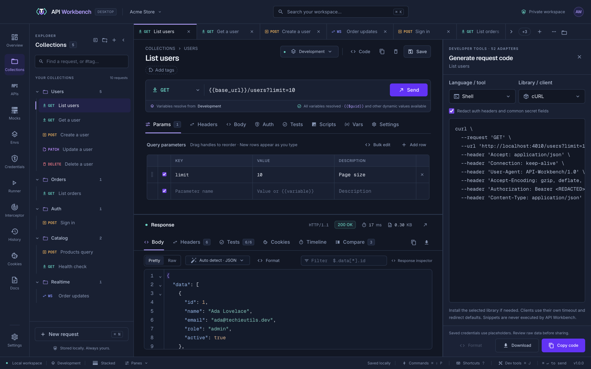

# Code snippets

Click **Code** in the request heading to open the generator beside the request. Pick a language and a library; the snippet updates as you edit the request. **Format** tidies JavaScript, TypeScript, JSON, and YAML snippets with the same formatter as the editors (it is also in the code's right-click menu); **Copy** or **Download** it, as shown. Changing the language, library, or request shows freshly generated code again.

## HTTP and GraphQL

26 languages and tools with 52 client libraries:

| Language / tool                        | Libraries / clients                                                  |
| -------------------------------------- | -------------------------------------------------------------------- |
| Shell                                  | cURL, Wget, HTTPie                                                   |
| JavaScript / TypeScript                | Fetch, Axios; JavaScript also jQuery and XHR                         |
| Node.js                                | HTTP, Request, Unirest, Axios, node-fetch, Native Fetch, Got, Undici |
| Python                                 | http.client, Requests                                                |
| Go                                     | net/http                                                             |
| Java                                   | java.net.http, OkHttp, Unirest, AsyncHttp                            |
| C# / .NET                              | HttpClient, RestSharp                                                |
| PHP                                    | cURL, Guzzle, HTTP v1/v2                                             |
| Ruby                                   | Net::HTTP, Faraday                                                   |
| C / C++                                | libcurl, CPR                                                         |
| PowerShell / CMD                       | Invoke-WebRequest, Invoke-RestMethod, curl.exe                       |
| Kotlin, Perl, Swift, Rust, R, and more | Native clients                                                       |
| Ansible / Terraform                    | uri; HTTP provider or terraform_data + cURL                          |

## Realtime protocols

Live requests get native clients for their protocol:

| Protocol  | Languages and libraries                                                                             |
| --------- | --------------------------------------------------------------------------------------------------- |
| WebSocket | websocat, JavaScript (browser WebSocket), Node.js (ws), Python (websockets), Go (gorilla/websocket) |
| SSE       | cURL, JavaScript (EventSource or a Fetch stream), Node.js (Fetch), Python (Requests), Go (net/http) |
| NDJSON    | cURL with jq, JavaScript and Node.js (Fetch), Python (Requests), Go (net/http)                      |
| gRPC      | grpcurl, Node.js (@grpc/grpc-js), Python (grpcio)                                                   |
| Socket.IO | Node.js and browser JavaScript (socket.io-client), Python (python-socketio)                         |
| MQTT      | mosquitto_pub and mosquitto_sub, Node.js (MQTT.js), Python (paho-mqtt)                              |

gRPC code follows the method's call type and expects the Schema tab's definition saved as `service.proto`. MQTT code turns Basic auth into the broker username and password.

## Safe to share

> [!TIP]
> **Redact auth headers and common secret fields** is on by default, and saved credentials always appear as placeholders, so snippets are safe to paste into a ticket or chat. Generated code is never run by the app.

## From the command line

`api-workbench request code <request> --lang <id>` generates the same code from a terminal, with secrets always redacted; `request code --list` lists the languages. See [Collections and requests](cli.md#collections-and-requests).
