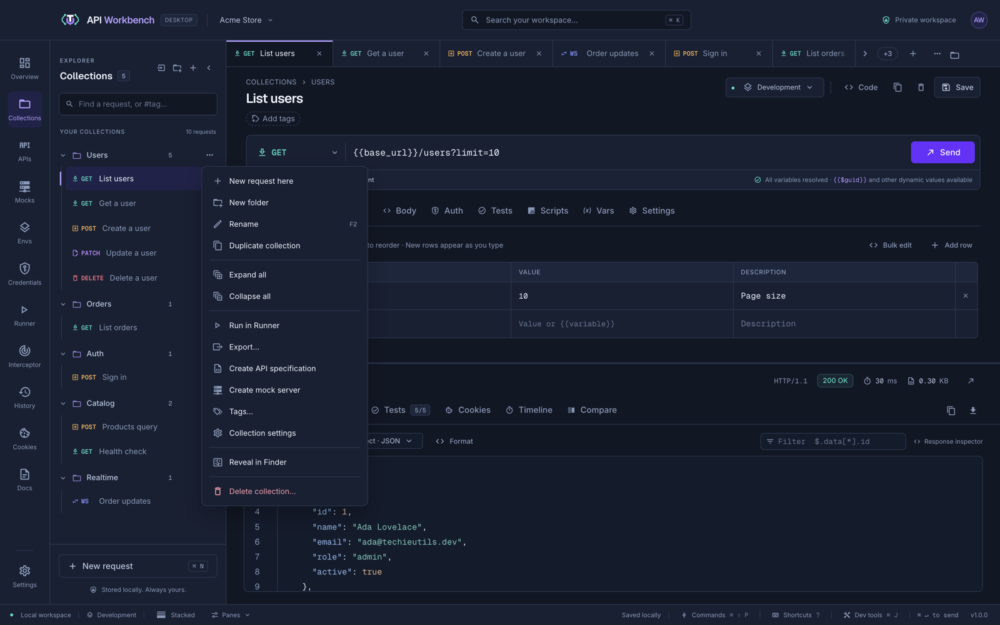

# Collections

Requests live in **collections**, the folders in the explorer on the Collections screen.

## Create and rename

- **New collection** at the top of the explorer starts a collection with one blank request, its name ready to type.
- **Double-click** a collection or request — or select it and press <kbd>F2</kbd> — to rename it in place. <kbd>Enter</kbd> saves and <kbd>Esc</kbd> cancels. A name another collection already uses is refused, and your typing stays in the field to fix.

## Collection menu

Hover a collection to show its settings button, and open its **⋯** menu:

| Action                            | What it does                                                                                                                                 |
| --------------------------------- | -------------------------------------------------------------------------------------------------------------------------------------------- |
| **New request here**              | Adds a blank request at the end of the collection and opens it                                                                               |
| **New folder**                    | Starts a [folder](#folders) in the collection, its name ready to type                                                                        |
| **Rename**                        | Edits the name in place                                                                                                                      |
| **Duplicate collection**          | Copies its requests, folders, settings, and authorization as "… copy"                                                                        |
| **Expand all** / **Collapse all** | Opens or closes the collection and every folder in it                                                                                        |
| **Run in Runner**                 | Opens the [Runner](runner.md) on this collection                                                                                             |
| **Export…**                       | Opens [Export](import-export.md#export-and-share) for this collection                                                                        |
| **Collection settings**           | HTTP settings shared by its requests                                                                                                         |
| **Reveal in Finder**              | Shows the collection's folder on disk, where each request is a YAML file (**Show in File Explorer** on Windows, **Show in folder** on Linux) |
| **Delete collection…**            | Asks first, then removes its requests, folders, settings, and authorization                                                                  |

## Folders

Folders organise a collection's requests, and can hold folders of their own. **New folder** in a collection's or folder's **⋯** menu starts one with a blank request, its name ready to type — like collections, a folder exists through the requests in it.

- A folder's **⋯** menu offers **New request here**, **New folder**, **Rename**, **Expand all**, **Collapse all**, **Folder settings**, the file manager item (see below), and **Delete folder…**. Deleting asks first and removes everything inside it, settings included.
- Renaming a folder moves everything inside it, settings included. Names cannot contain `/`, and two folders in the same place cannot share a name.
- A folder can have its own HTTP settings and default authorization. Settings layer per field from the collection through each folder to the request; a request set to **Inherit from collection** uses the nearest folder (or the collection) that sets authorization, and a folder left on **Inherit from collection** passes on what is above it. Choose the level in the **Settings** or **Auth** tab — **This request**, each folder above it, then **Collection** — or open it with a folder's settings button.
- Running, exporting, and documenting a collection include its folders.
- Folders imported from Postman, Insomnia, Hoppscotch, and Bruno keep their nesting.

## Move and reorder requests

- **Drag** a request onto another collection or a folder to move it, or onto another request to place it before or after — a line shows where it lands.
- A request's **⋯** menu offers **Move to** (any collection or folder), **Move up**, **Move down**, **Rename**, **Duplicate**, and **Delete**.
- With a request focused, <kbd>Alt</kbd>+<kbd>↑</kbd> / <kbd>↓</kbd> moves it within its folder.

> [!TIP]
> Moving a request to another collection shows a notification with **Undo**.

## Files on disk

Each collection is a folder in the workspace's `collections` folder, with a folder for each folder in it and a readable YAML file per request. Edit them in any editor, or update them with git, while the app is open: changes — and changes to `workspace.json` and `workspaces.json` — reload into the window with a notice. A file with invalid YAML is left alone until you fix it. See [where your data is stored](installation.md#where-your-data-is-stored).

## Context menus

Right-click a collection, folder, or request in the explorer for the same actions as its **⋯** menu.

## Shared defaults

A collection can hold defaults its requests inherit:

- **Authorization** — set it in any request's **Auth** tab with the **Collection** switch, and choose **Inherit from collection** in the requests that should use it. See [Authorization](authentication.md).
- **HTTP settings** — timeouts, TLS, proxy, and more, from the collection's gear. See [Settings](settings.md#http-settings).

Renaming a collection keeps its defaults, Runner baselines, and Docs selection.
