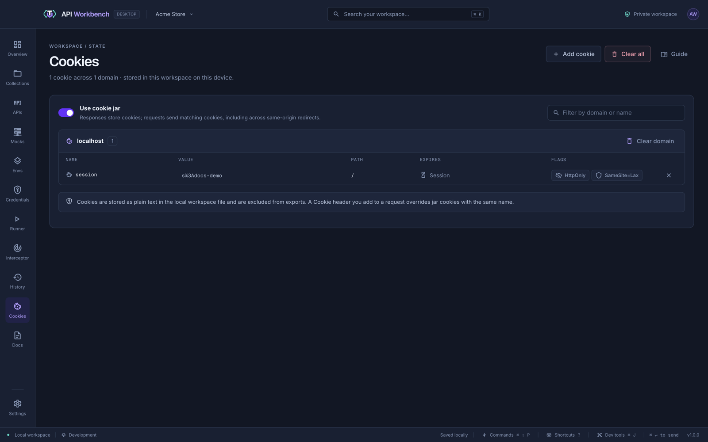

# Cookies

With **Use cookie jar** on, responses store their cookies and later requests send the matching ones, as a browser would — including across same-origin redirects.

## Manage cookies

Open **Cookies** in the navigation rail to:

- See cookies grouped by domain, with their path, expiry, and flags.
- Filter by domain or name.
- **Add** a cookie by hand.
- Delete one cookie, every cookie for a domain, or all of them — each asks first.

Turn the jar off to stop storing and sending cookies; saved cookies are kept until you delete them.

## Precedence

A `Cookie` header you set on a request overrides jar cookies with the same name. Each response's **Cookies** tab shows what that response set.

> [!NOTE]
> Cookies are stored in the workspace file and are never included in exports.

## From the command line

`api-workbench cookie list` shows the jar's cookies without their values; `cookie delete` and `cookie clear` remove them. See [History and cookies](cli.md#history-and-cookies).
