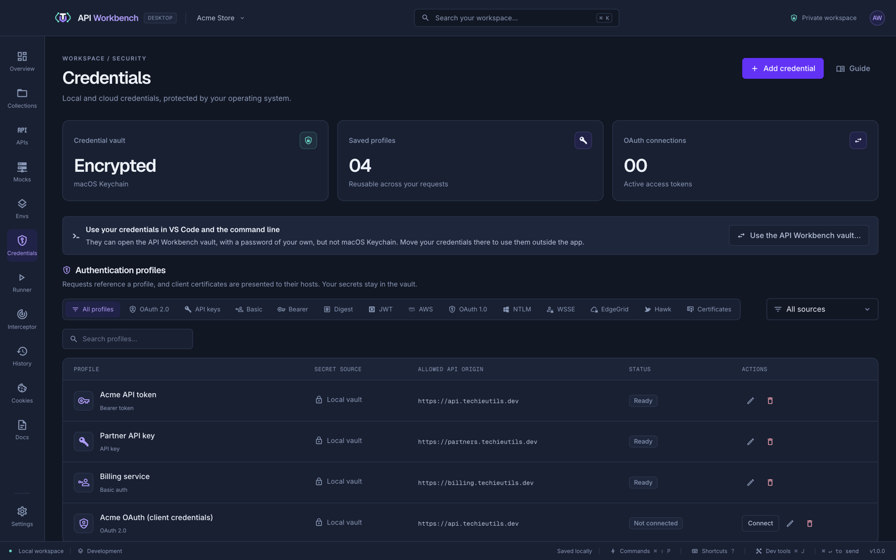

# Credential vault

Open **Credentials** to manage profiles: Bearer tokens, API keys, Basic, Digest, NTLM, and WSSE logins, JWT, AWS, OAuth 1.0, Akamai EdgeGrid, Hawk, OAuth 2.0, and client certificates.

- **Encrypted by your operating system.** The vault uses macOS Keychain, Windows DPAPI, or the Linux Secret Service (GNOME Keyring or KWallet). Where the system has no credential store, the [API Workbench vault](#the-api-workbench-vault) keeps your credentials instead, under a password of your own. Nothing is ever stored as plain text.
- **Restricted to one origin.** Every profile has an **Allowed API origin**, such as `https://api.techieutils.dev`, and is only ever sent to that exact scheme, host, and port.
- **Kept out of the renderer.** Secrets stay in the app's main process; the screens only see names and metadata. They are never included in exports, generated code, or backups.
- **Unlocked when you need it.** The keychain is first asked when you open **Credentials**. If a request needs the vault while it is locked, the error offers **Unlock vault and resend** right where you are.

To use a profile, choose **Saved credential** in a request's Auth tab and select it. Each workspace has its own vault.

Signed and negotiated profiles (Digest, NTLM, WSSE, JWT, AWS, OAuth 1.0, Akamai EdgeGrid, and Hawk) are applied in the main process when the request is sent, with the same fields as the Auth tab. EdgeGrid keeps both the client secret and the access token encrypted. An NTLM profile works with HTTP requests only.

## Secrets from cloud providers

A profile's **Secret source** can be the local vault or an external secret store. The value is fetched each time it is used, never cached, and never written back.

| Provider                                                | Authentication                                                         |
| ------------------------------------------------------- | ---------------------------------------------------------------------- |
| AWS Secrets Manager and Systems Manager Parameter Store | The default SDK chain, a shared profile, or access keys                |
| Azure Key Vault                                         | Entra client credentials or an existing access token                   |
| Google Cloud Secret Manager                             | Application Default Credentials, a service account, or an access token |
| HashiCorp Vault / OpenBao                               | Token or AppRole; KV v1 and v2                                         |
| SAP BTP Credential Store                                | Service key with payload decryption                                    |

For a structured secret, set **JSON Pointer to secret value**, for example `/api_key`. **Test access** checks authentication, permissions, and the field without showing the value.

## The API Workbench vault

When the system has no credential store — such as a Linux computer without GNOME Keyring or KWallet, where Electron would otherwise keep secrets as plain text — API Workbench uses its own vault. **Credentials** shows it in place of the keychain.

1. **Set up:** choose a vault password of at least 12 characters, mixing letters with numbers or symbols (or a passphrase of 20 characters or more). The meter shows how strong it is.
2. **Save your recovery key:** **Save to a file…** or **Copy** (the clipboard is cleared after a minute), then confirm you have put it somewhere safe, such as a password manager. The recovery key is the only way back if you forget the password. It is never shown in the window, and cannot be made again.
3. **Unlock** with your password when you start working. The vault **locks after 15 minutes without use**, when you click **Lock now**, and when API Workbench quits; locking forgets the credentials until you unlock again. Errors that need the vault elsewhere offer a password field right there.

**Forgot your password?** on the unlock form takes your recovery key and a new password. **Change password** needs the current one. **Reset vault…** deletes the vault and every credential it holds in every workspace, after asking; they cannot be recovered.

How it protects your secrets:

- Credentials are encrypted with AES-256-GCM using a random data key. That key is stored only encrypted: once with a key derived from your password (scrypt, about 128 MB of work per attempt), and once with your recovery key. Changing the password re-encrypts only that key.
- The password, the data key, and the recovery key stay in API Workbench's main process; the window sends the password once and forgets it.
- After five wrong attempts, each further one waits longer, up to a minute.
- One vault password covers every workspace on this computer; each workspace's credentials are still kept in its own file. The Interceptor's local CA key is kept by the same vault.

Where the system's credential store is available, it is used, and the API Workbench vault is not needed — unless you choose it.

### Use your credentials in VS Code and the command line

The [command line](cli.md) and the [VS Code extension](vscode.md) can open the API Workbench vault with its password, but never the system's credential store. To use your saved credentials there on a computer that has one (macOS, Windows, most Linux desktops), choose **Use the API Workbench vault…** in **Credentials**, and confirm. Then set up the vault as above (or unlock it, if you set it up before): every workspace's credentials move from the system's store into it, encrypted again under your vault password, and new ones are kept there too. The vault panel says it was chosen.

**Go back to** _the system's store_**…** in the vault panel moves them back, once the vault is unlocked; before you set the vault up, **Keep using** _the system's store_ undoes the choice. In VS Code, unlock the vault with its password once, and choose **Remember in the system keychain** to have VS Code unlock it on its own in new windows.

## If the vault cannot open

| Message                                         | What to do                                                                                                             |
| ----------------------------------------------- | ---------------------------------------------------------------------------------------------------------------------- |
| _The credential vault is locked._               | Click **Unlock vault** in the error, or open **Credentials**.                                                          |
| _The API Workbench vault is locked._            | Enter your vault password in the error or in **Credentials**, or use your recovery key under **Forgot your password?** |
| _This computer has no system credential store._ | Set up the [API Workbench vault](#the-api-workbench-vault) in **Credentials**.                                         |
| _Your system keychain may have denied access._  | Allow access when the system asks, then click **Try again**.                                                           |
| _OS-backed encryption is unavailable._          | Unlock your system keychain (or start a keyring on Linux), then click **Restart app**. Your workspace is saved first.  |

See [Troubleshooting](troubleshooting.md#the-credential-vault) for more.

## From the command line

`api-workbench secret set` adds a Bearer, Basic, or API key credential to the API Workbench vault, reading its secret from standard input or an environment variable; `secret list` shows names and origins, never values. See [Saved credentials](cli.md#saved-credentials).
