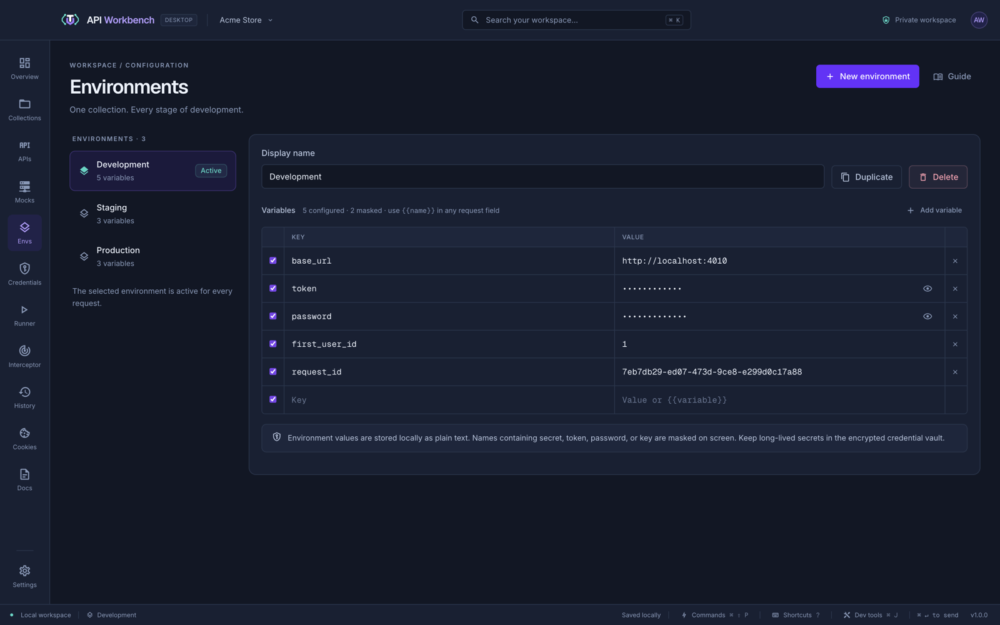

# Environments

Variables keep hosts, IDs, and tokens out of your requests, so the same collection works against development, staging, and production.

An environment is a named set of variables. Write `{{name}}` in a request, and the value comes from the **active environment** when it is sent — so switching environments points every request at another stage. See [Variables](variables.md) for everything else about variables.

## Environments

Open **Environments** to create, rename, duplicate, or delete environments, and to edit their variables. Select one to make it **active**; it applies to every request. You can also switch from the environment picker in a request's heading.

A typical setup is one environment per stage, with the same variable names in each:

| Variable   | Development             | Staging                               | Production                    |
| ---------- | ----------------------- | ------------------------------------- | ----------------------------- |
| `base_url` | `http://localhost:4010` | `https://staging.api.techieutils.dev` | `https://api.techieutils.dev` |
| `token`    | a local test token      |                                       |                               |

Variables whose names contain _secret_, _token_, _password_, or _key_ are masked on screen; click the eye to reveal one.

> [!WARNING]
> Environment values are saved as plain text in the workspace file. Keep long-lived secrets in the [credential vault](credentials.md), which is encrypted.

## Variables in an environment

Each environment is a list of variables, each with a name, a value, and a switch: a variable that is switched off is kept but not used. Requests use them as `{{name}}`.

How values are chosen when a request is sent, how the **Vars** tab captures values from responses, the built-in dynamic values such as `{{$guid}}`, and how scripts, data files, and the command line set variables are covered in [Variables](variables.md).

## From the command line

`api-workbench environment set Staging base_url=https://staging.example.com` sets variables from a terminal, and `environment show` lists them with secret-looking values hidden. See [Environments](cli.md#environments).
