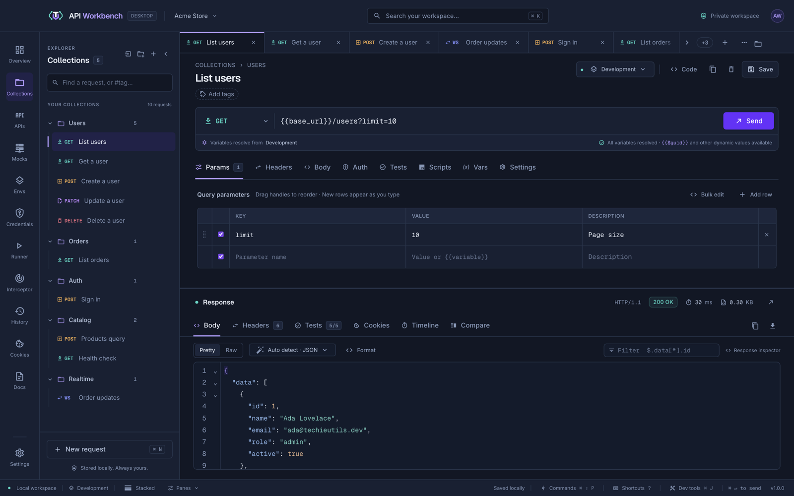

# Quick start

This walkthrough takes you from a fresh install to a tested request. If API Workbench is not installed yet, start with [Installation](installation.md).

## 1. Send a request

1. Click **New request** in the explorer, or press <kbd>⌘/Ctrl</kbd>+<kbd>N</kbd>.
2. Leave the method (the select at the start of the URL bar) on **GET** and enter `https://httpbin.org/get?hello=world`. The query parameter appears in the **Params** table; edits in either place stay in sync.
3. Click **Send**, or press <kbd>⌘/Ctrl</kbd>+<kbd>Enter</kbd>.

The response appears with its status, time, and size, and JSON is formatted for you.



> [!NOTE]
> Requests save automatically. <kbd>⌘/Ctrl</kbd>+<kbd>S</kbd> saves at once.

## 2. Use an environment

Put hosts and tokens in an environment instead of typing them into every request.

1. Open **Environments** and select **Development** — every new workspace has one.
2. Add a variable `base_url` with your API's address, for example `https://httpbin.org`.
3. Change the request URL to `{{base_url}}/get`.

The line under the URL bar shows which environment the variables come from and warns about any it cannot resolve. Learn more in [Environments and variables](environments.md).

## 3. Add a test

Open the request's **Tests** tab and add one assertion per line:

```text
status 200
response-time < 1000
json-exists $.args.hello
```

Send again: the response's **Tests** tab shows each check passing or failing, with the actual value. Prefer forms? Switch to the **Visual builder**. See [Tests](tests.md).

## 4. Organize and run

- Requests live in **collections**, the folders in the explorer. Create one with **New collection**, and use its **⋯** menu to add requests, run it, export it, and more — see [Collections](collections.md).
- Open **Runner** to run a collection with its tests, benchmark it, or load test it — see [Runner](runner.md).

## Next steps

```cards
- title: Import your collections
  icon: import
  href: import-export.md
  text: Postman, Bruno, Insomnia, Hoppscotch, OpenAPI, HAR, cURL, and more.
- title: Keep secrets safe
  icon: shield-lock-outline
  href: credentials.md
  text: Move tokens into the encrypted credential vault.
- title: Test a REST API end to end
  icon: compass-outline
  href: guides/test-a-rest-api.md
  text: A complete walkthrough with chained requests and a collection run.
```
