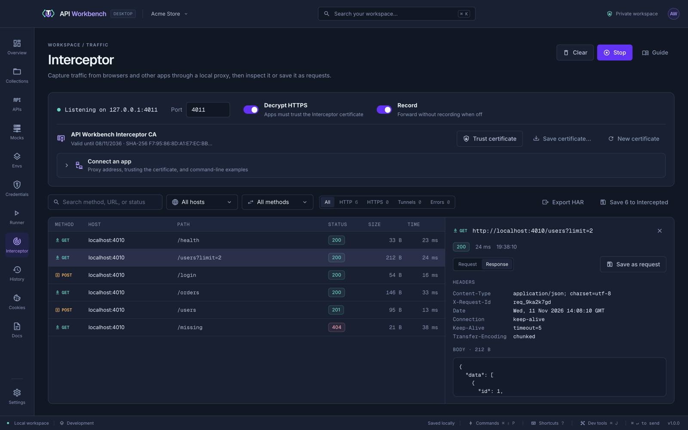

# Capture and replay app traffic

The [Interceptor](../interceptor.md) is a local proxy: point an app at it and every request it makes appears in API Workbench, ready to save and replay.

## 1. Start the Interceptor

1. Open **Interceptor** and click **Start**. It listens on `127.0.0.1:8899`.
2. Keep **Decrypt HTTPS** on to read HTTPS traffic.

## 2. Trust the certificate

To read HTTPS, the app must trust the Interceptor's certificate authority:

- **macOS and Windows:** click **Trust certificate** and confirm the system prompt.
- **Firefox, Node.js, Java, cURL, Linux:** click **Save certificate…** and add the file to that app's trust store, for example `NODE_EXTRA_CA_CERTS` for Node.js or `--cacert` for cURL.

> [!WARNING]
> Only trust the certificate on machines you control, and remove it when you are done. It is encrypted with your OS, like the credential vault.

## 3. Point the app at the proxy

| App                           | How                                                                                |
| ----------------------------- | ---------------------------------------------------------------------------------- |
| Chrome                        | Start it with `--proxy-server=127.0.0.1:8899`                                      |
| Any app using system settings | Set `127.0.0.1:8899` as the HTTP and HTTPS proxy in your network settings          |
| Node.js                       | `HTTP_PROXY=http://127.0.0.1:8899 HTTPS_PROXY=http://127.0.0.1:8899`               |
| cURL                          | `curl -x http://127.0.0.1:8899 --cacert <certificate> https://…`                   |
| iOS Simulator                 | Set the Mac's system proxy, and install and trust the certificate in the simulator |

**Connect an app** in the Interceptor has these examples ready to copy.

## 4. Find the requests you need

Use the app normally, then narrow the list with the search box, the **Host** and **Method** filters, and the HTTP, HTTPS, tunnels, and errors filters. Click a capture to see its headers and body.

## 5. Save and replay

- **Save as request** adds the capture to the **Intercepted** collection and opens it — edit anything and **Send**.
- **Save N to Intercepted** saves every capture shown.
- **Export HAR** downloads them for browser dev tools and other tools.

From there, add [tests](../tests.md), move the requests into your own [collections](../collections.md), and [generate code](../code-snippets.md).
