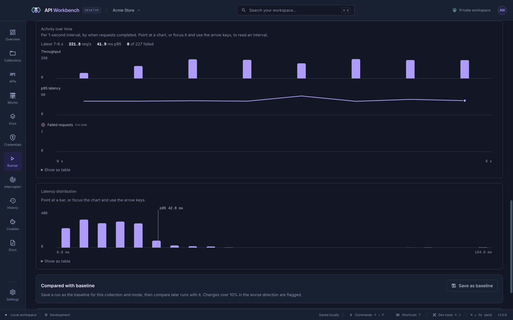

# Load test an API

The [Runner](../runner.md) measures how fast an API answers and how it holds up under load, with percentiles, confidence intervals, and charts.

> [!WARNING]
> Load testing sends many requests quickly. Test APIs you own or are allowed to test, and prefer a staging environment.

## 1. Benchmark the endpoints

A **benchmark** sends a fixed number of requests to each endpoint.

1. Open **Runner**, choose the collection and environment, and select the requests.
2. Set **Run mode** to **API benchmark**.
3. Set **Iterations per request** (for example 200), **Concurrent workers** (for example 10), and **Warm-up iterations** (for example 10 — excluded from the results).
4. Click **Start benchmark**.

Read **p50**, **p95**, and **p99** latency rather than the average: they show what most users, and the slowest ones, experience. **Network p95** and **time to first byte** leave out the client's own overhead.

## 2. Run a performance test

A **performance test** keeps sending requests for a set duration. Choose a load model:

| Load model              | Behaviour                                                                                                                        | Use it to                                                  |
| ----------------------- | -------------------------------------------------------------------------------------------------------------------------------- | ---------------------------------------------------------- |
| **Concurrent workers**  | Each worker sends its next request when the last one finishes; a slower API gets less load                                       | Simulate a fixed number of busy users                      |
| **Target request rate** | Requests start on a fixed schedule whatever the latency; starts that would exceed the in-flight limit are counted as **dropped** | Simulate real traffic at a known rate, and find saturation |

Add a **ramp-up** to raise the load gradually.



**Activity over time** shows throughput, p95 latency, and failures per second; **Latency distribution** shows the spread with p95 marked.

## 3. Set pass/fail thresholds

Under **Success criteria and thresholds**, set the successful status range and limits for **p95 latency**, **error rate**, and **minimum throughput**. The result shows each threshold as passed or failed.

## 4. Save a baseline and compare

Click **Save as baseline**. Later runs of the same collection and mode show the change in throughput, latency, and error rate, flagging regressions over 10%.

## 5. Export the report

- **Export JSON** — configuration, thresholds, timeline, errors, and every sample.
- **Export CSV** — every sample, for spreadsheets.
- **Resources CSV** — the app's CPU and memory during the run.

> [!NOTE]
> The runner measures from your machine. Its CPU and network limit how much load one client can generate — check **Application resources** in the results.

## 6. Run it in CI

The same test runs from the [command line](../cli.md#load-tests), so a slow release fails its build:

```sh
node api-workbench.cjs run ./api -c Orders -e Staging --duration 30 --concurrency 10 --p95 500 --max-error-rate 1
```

See [Run API tests in CI](run-api-tests-in-ci.md) for pipeline setups.
