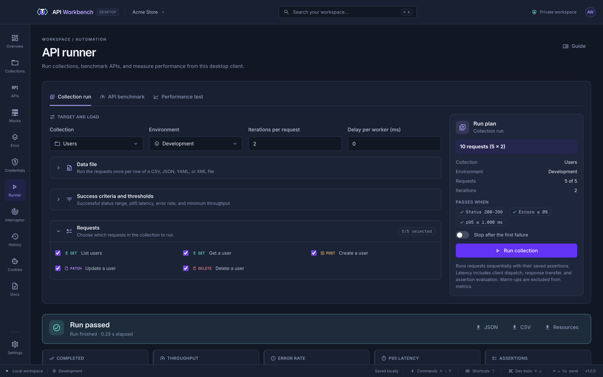

# Test a REST API end to end

In this guide you build a small test suite for [JSONPlaceholder](https://jsonplaceholder.typicode.com), a free fake REST API, and run it as a collection. Swap in your own API as you go.

## 1. Create an environment

1. Open **Environments** and select **Development**.
2. Add `base_url` = `https://jsonplaceholder.typicode.com`.
3. Add `user_id` = `1`.

## 2. Create a collection

1. In the explorer, click **New collection** and name it `Users API`.
2. Rename its first request (double-click it) to `List users`, and set the URL to `{{base_url}}/users`.
3. From the collection's **⋯** menu, choose **New request here** twice more, for:
   - `Get a user` — `GET {{base_url}}/users/{{user_id}}`
   - `Create a post` — `POST {{base_url}}/posts`, with a **Raw** JSON body:

     ```json
     { "userId": {{user_id}}, "title": "Hello", "body": "From API Workbench" }
     ```

## 3. Add tests

Give each request tests in its **Tests** tab:

```text
// List users
status 200
response-time < 2000
json-type $ array
json-length $ > 0
```

```text
// Get a user
status 200
json $.id equals 1
json-exists $.email
header content-type contains application/json
```

```text
// Create a post
status 201
json $.title equals "Hello"
json-exists $.id
```

Send each request: its response's **Tests** tab shows every check with its result.

> [!TIP]
> Not sure of the syntax? The **Visual builder** in the Tests tab builds the same assertions from forms.

## 4. Run the collection

1. Open the collection's **⋯** menu and choose **Run in Runner**.
2. Keep **Collection run**, choose **Development**, and click **Run collection**.

The results show every request, its status, timing, and assertion totals. **Export JSON** or **Export CSV** saves the report.



## 5. Run it against another stage

Create a **Staging** environment with the same variable names and a different `base_url`, pick it in the Runner, and run again — the tests stay the same.

## Next

- Carry values between requests: [Chain requests with captured variables](chain-requests.md).
- Share the suite: [export the collection](../import-export.md#export-and-share) as API Workbench JSON, Postman, or Bruno.
