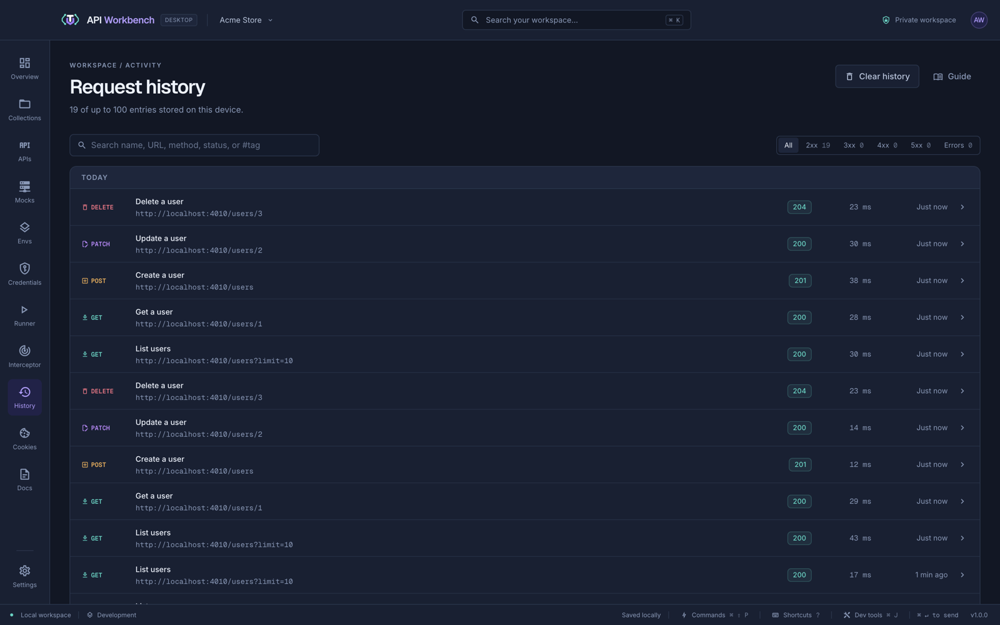
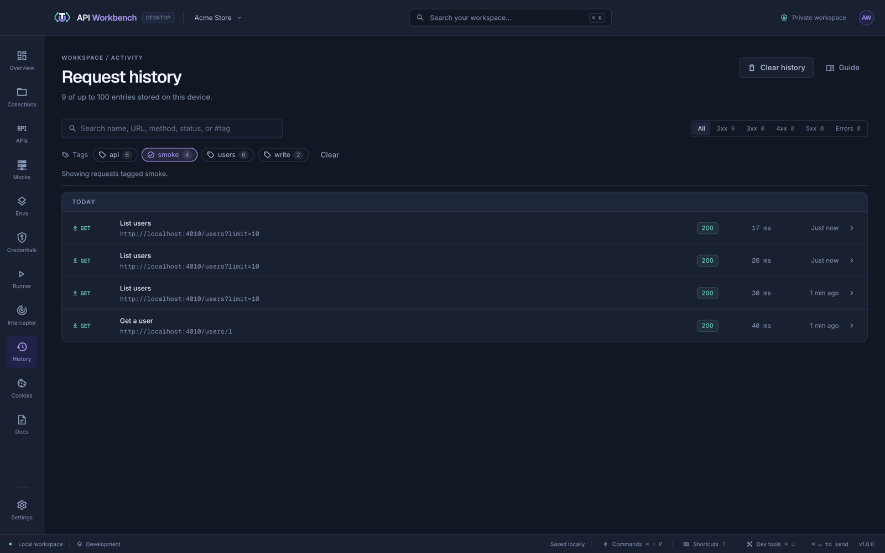

# History and console

## History

**History** lists the requests you have sent, grouped by day, with their status, duration, and when they ran.

- Search by name, URL, method, status, or tag (`#smoke` for one tag exactly), and filter by status class: 2xx, 3xx, 4xx, 5xx, or errors.
- **Filter by tag:** the **Tags** bar under the search lists the [tags](requests.md#tags) of the requests you have sent — their own and their collection's and folders' — with how many entries each has. Click a tag to show only what was sent from requests with it, again to hide those instead, and again to stop; **Any tag** and **All tags** choose how several combine, and **Clear** removes the filter. It works with the search and status filters. An entry whose request was deleted has no tags, so a tag filter leaves it out.

  

- Click an entry to see its response beside the list: the status, time, size, body, headers, the cookies it set, its network timing, and its TLS certificate. **Compare** diffs it with another kept response of the same request — the one sent just before, unless you choose another — like a response's [Compare](responses.md). **Preview** renders a kept HTML or Markdown body. **Tests** runs the request's current tests on the kept response. **Console** shows the request console's lines for that send. A failed request shows its error, its **Console**, and the **Timeline** and **Certificate** it got as far as. **Format** (also in the body's right-click menu) tidies the body, and **Copy** copies it. **Open request** — or double-clicking the entry — opens the request.
- In the body, right-click a JSON value (or select text in other bodies) and choose **Capture value**, as in a [response](variables.md#capture-values-from-responses). A body cut short at 256 KB is not complete JSON, so select the text to capture there.
- In **Headers**, right-click a header to copy it or **Capture into a variable** (`header <name>`); the `set-cookie` row also lists each cookie under **Capture a cookie**. In **Cookies**, right-click a cookie to copy its value or **Capture into a variable** (`cookie <name>`). In **Timeline**, right-click the total or a phase to copy its duration or capture it (`timing <phase>`; a phase of an earlier redirect is numbered, as in `timing dns 1`). In **Certificate**, right-click a field to copy it or capture it (`certificate <field>`; a certificate after the leaf is numbered, as in `certificate valid-to 2`). In **Compare**, right-click a JSON line of either side, a changed header, or the status, time, or size chip to capture it. In **Tests**, right-click a result to capture the value its assertion checks, such as `$.id` for `json $.id equals 7`. In **Console**, right-click the outcome line to capture the status, time, or size it reports, or the cookie line to capture a cookie. For a failed request, right-click the error, or the failure line in **Console**, to capture `error`. In **Preview**, right-click an element of an HTML page, or selected text, to capture it. In each case the request opens on its **Vars** tab with the new capture, so later sends save that value. Capturing needs the request to still exist.
- Responses are kept for requests you send from the editor, with bodies up to 256 KB (files such as images are not kept). They stay for this session — with each send's console lines, and a failed request's error, timing, and certificate — and are saved with the workspace only while **Persist response bodies** is on in **Settings → Privacy**. Runner runs have no response to show.
- **Clear history** asks first, then removes every entry — your requests and their saved responses are not affected.

Set how many entries to keep, or turn history off, in **Settings → Privacy**. History stays on this device and is never exported.

## Request console

Press <kbd>⌘/Ctrl</kbd>+<kbd>J</kbd> to open the console under the request. It logs each request's start and completion, errors, cancellations, timings, sizes, and test summaries.

- Filter by the current request or all requests, by level, or by text, and copy what matches.
- Query values are redacted, and bodies and header values are never logged.
- The console keeps the latest 300 entries in memory only.

## From the command line

`api-workbench history list` shows recent sends, including those made with `request send`, and `history clear` clears yours. See [History and cookies](cli.md#history-and-cookies).
