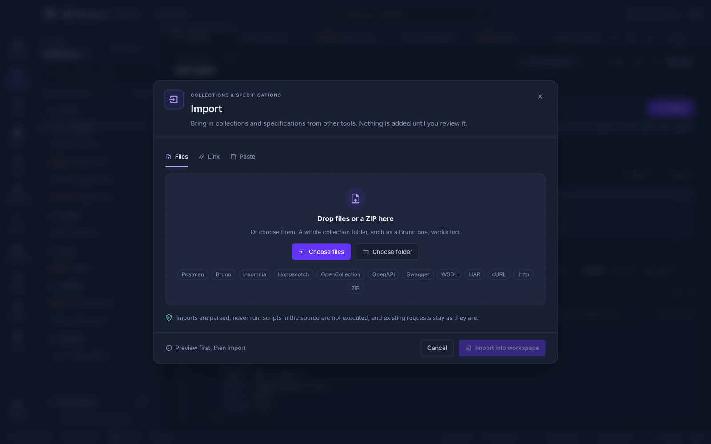
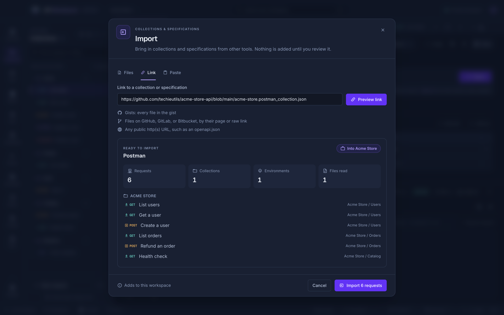
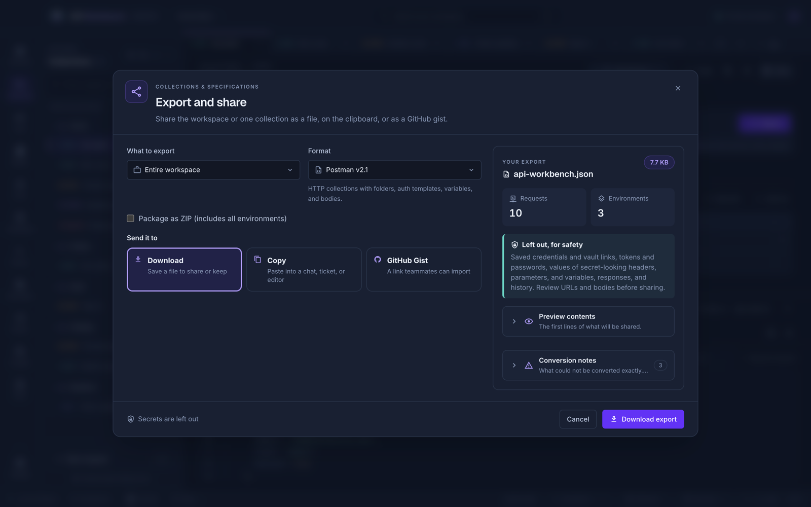
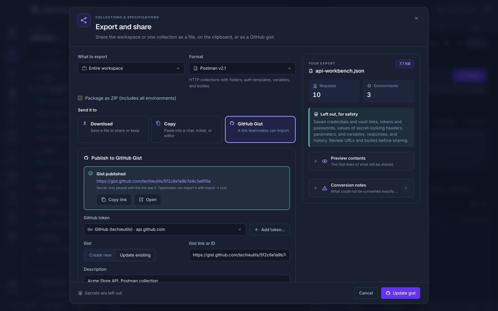

# Import and export

Bring collections in from other tools, and take them out again.

## Import

Click **Import** in the explorer, on the Overview, in Docs, or in **Settings → Data**. Then choose where it comes from:

- **Files** — drop files or a ZIP on the dialog, or use **Choose files**. **Choose folder** reads a whole collection folder, such as a Bruno collection.
- **Link** — paste a link and click **Preview link**:
  - a gist, such as `https://gist.github.com/ada/0123…`: every file in it is imported;
  - a file on GitHub, GitLab, or Bitbucket, by its page link (`…/blob/main/orders.json`) or raw link;
  - any `http://` or `https://` URL to a collection or specification, such as an API's `openapi.json`.
- **Paste** — paste a collection, specification, or cURL command, and click **Preview pasted content**.

Links are downloaded without credentials, so only public ones work (secret gists work too, since their link is enough). For a private repository, clone it as a [team workspace](team-workspaces.md#share-through-github-gitlab-or-bitbucket) or download the file. Downloads are limited to 10 MB, like chosen files, and are read by the same importers: nothing in them is run.

The preview counts the requests, collections, environments, and files it found, lists the requests by collection, and adds notes about anything that could not be converted. **Import** adds everything only if the whole input is valid, so a failed import changes nothing.

## Supported formats

| Format                 | Import                                                                                                                                                   | Export                                                   |
| ---------------------- | -------------------------------------------------------------------------------------------------------------------------------------------------------- | -------------------------------------------------------- |
| **API Workbench**      | Workspace and collection JSON, environments                                                                                                              | JSON with every protocol, setting, environment, and test |
| **Postman**            | v2.0 and v2.1 collections and environments, with folders, auth, raw, GraphQL, and form bodies                                                            | v2.1 collection JSON                                     |
| **Bruno**              | `.bru` files, folders, ZIPs, and collection JSON                                                                                                         | `.bru` requests and environments                         |
| **OpenCollection**     | Bundled YAML and individual files                                                                                                                        | Bundled YAML                                             |
| **Insomnia**           | v4 JSON and v5 YAML                                                                                                                                      | v5 YAML or v4 JSON                                       |
| **Hoppscotch**         | REST and GraphQL collection JSON and environment JSON                                                                                                    | —                                                        |
| **OpenAPI / Swagger**  | OpenAPI 3.x and Swagger 2.0, JSON or YAML                                                                                                                | OpenAPI 3.1 or Swagger 2.0                               |
| **WSDL / SOAP**        | Generates SOAP 1.1/1.2 request templates                                                                                                                 | A WSDL 1.1 service skeleton                              |
| **HAR**                | HAR 1.2 entries                                                                                                                                          | HAR 1.2 requests                                         |
| **cURL**               | Commands (parsed, never run)                                                                                                                             | Shell-quoted commands                                    |
| **HTTP / REST Client** | `.http` and `.rest` files with variables; `< ./path` file bodies and multipart forms come in as file bodies and form file fields, whose files you choose | Plain-text requests                                      |
| **ZIP**                | Any mix of the above                                                                                                                                     | Any format, as an archive                                |

OpenAPI imports become requests grouped by tag, with servers, parameters, examples, and generated example bodies. Missing servers use `{{base_url}}`. Remote references are never fetched, and scripts from other tools are never imported or run. Request [scripts](scripts.md) in API Workbench's own format are kept, and paused until you allow them.

Moving from another tool? The [migration guides](guides/migrate.md) walk through exporting from Postman, Insomnia, Bruno, Hoppscotch, and more, and what to check afterwards.

Limits: 10 MiB per document, 50 MiB in total, and up to 1,000 files and 10,000 requests per import.

## Export and share

Use **Export** in the explorer or **Settings → Data → Choose format**. Choose **What to export** (the whole workspace or one collection) and a **Format** from the list above, optionally as a ZIP. The summary beside the options shows the file's name and size, how many requests and environments it holds, and its conversion notes; open **Preview contents** to read the first lines before sharing.

Then choose where it goes under **Send it to**:

| Destination     | What happens                                                                     |
| --------------- | -------------------------------------------------------------------------------- |
| **Download**    | Saves the file                                                                   |
| **Copy**        | Copies it to the clipboard, to paste into a chat, ticket, or editor              |
| **GitHub Gist** | Publishes it as a gist and gives you its link; teammates import it with **Link** |

A ZIP can only be downloaded.

Exports never include credentials, vault data, responses, history, file contents, or recognized secrets such as inline tokens, passwords, and sensitive headers. Review custom variable names and bodies before sharing, as automatic redaction cannot recognize every secret.

### Publish to GitHub Gist

1. Choose **GitHub Gist**. The first time, unlock the credential vault if asked, click **Add token…**, and paste a GitHub token: a classic token with the `gist` scope, or a fine-grained token with **Gists: read and write**. For GitHub Enterprise Server, enter its address too. The token is saved in the vault as a Bearer token that only works for GitHub's API.
2. Choose **Secret** (not listed; anyone with the link can open it) or **Public** (listed on your profile), and add a description.
3. Click **Publish gist**, then **Copy link** or **Open**.

Publishing the same collection and format again updates that gist: **Update existing** is chosen with its link filled in. Paste another gist's link or ID to update that one instead. The token is used in the main process only; it never reaches the app's window, and the app refuses to publish an export that contains it.

To publish a collection as an API reference, see [API documentation](api-documentation.md).

## From the command line

`api-workbench collection import <file>` imports any of these formats, and `collection export <name> --format postman` exports one, from a terminal. A cURL command becomes a request with `request create --curl`. See [Collections and requests](cli.md#collections-and-requests).
