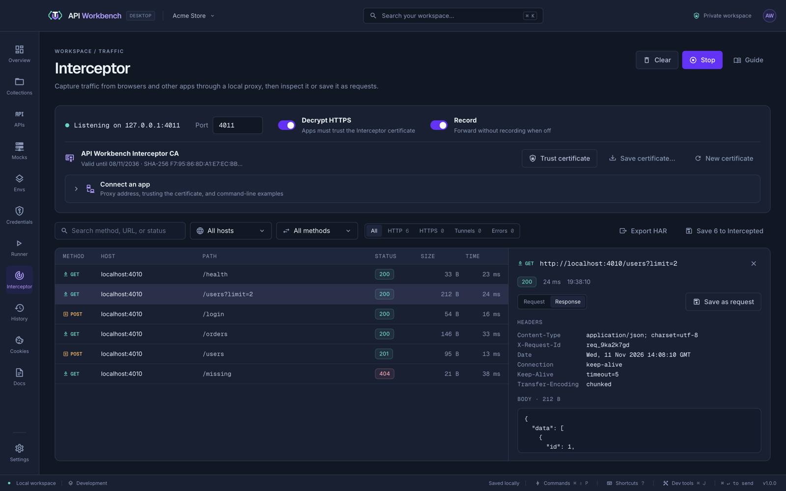

# Interceptor

The Interceptor shows what other apps send. It runs a capture proxy on your machine: point a browser, mobile simulator, CLI, or service at it, and every request and response appears as it happens. Save any of them as a request to replay and edit.



## Start capturing

1. Open **Interceptor** and click **Start**. It listens on `127.0.0.1:8899` by default; change **Port** while it is stopped.
2. Set `127.0.0.1:8899` as the **HTTP and HTTPS proxy** of the app you want to capture (in its settings, your browser's or system's network settings, or environment variables).
3. To see inside HTTPS, make the app trust the Interceptor's certificate (below).

Requests appear in the list as they are made. Click one to see its request and response headers and bodies beside the list. JSON is formatted, and compressed bodies (gzip, deflate, brotli) are decoded.

**Connect an app** has ready-to-copy examples:

```sh title="cURL"
curl -x http://127.0.0.1:8899 --cacert "<certificate path>" https://api.example.com
```

```sh title="Node.js"
HTTP_PROXY=http://127.0.0.1:8899 HTTPS_PROXY=http://127.0.0.1:8899 \
NODE_EXTRA_CA_CERTS="<certificate path>" node app.js
```

```sh title="Chrome"
--proxy-server=127.0.0.1:8899
```

## HTTPS decryption

With **Decrypt HTTPS** on (the default), the Interceptor creates its own certificate authority the first time it starts, and uses it to read HTTPS traffic. The first time you start it with decryption in each run of the app, API Workbench asks you to confirm in a dialog of its own, which nothing shown in the window can answer. Apps only accept the certificate if they trust it:

- **Domains to decrypt** is required with **Decrypt HTTPS** on: list the domains you test (comma or space separated). The certificate vouches only for them, their subdomains, and this computer — it is written into the certificate as X.509 name constraints, so even a copy of its key could not vouch for any other site's name — and HTTPS to other hosts passes through unread. **Start** stays unavailable until you list one, or turn decryption off. Changing the list makes a new certificate, which you trust again; a certificate from an earlier version, which could vouch for any site, is replaced the next time you start. Sites reached by a bare IP address, such as `https://203.0.113.5`, are not covered by the limit, but are passed through too.
- **Trust certificate** adds it to your user's trusted certificates on macOS and Windows. API Workbench asks you to confirm, saying when it expires, and then the system asks too.
- **Save certificate…** exports it for Linux, or for apps with their own trust store, such as Firefox, Node.js (`NODE_EXTRA_CA_CERTS`), Java, or cURL (`--cacert`).
- **New certificate** replaces it. If you trusted the old one with **Trust certificate**, it is removed from your trusted certificates first (the system asks you to confirm); if you decline, nothing is replaced. Remove it yourself from anywhere else you added it, such as Firefox or `NODE_EXTRA_CA_CERTS`.

The certificate lasts 30 days, so a copy of its key would stop working soon after. When it has less than two days left, the Interceptor makes a new one the next time it starts with decryption, and you trust that one again. A certificate made by an earlier version, which lasted ten years, is removed from your trusted certificates and replaced the first time decryption starts (the system asks you to confirm). The private key is encrypted with your operating system, like the [credential vault](credentials.md). Only trust the certificate on machines you control, and remove it when you no longer need it.

If an app does not trust the certificate, its connection fails and the Interceptor lists it as an error explaining why. With decryption off, HTTPS passes through untouched as a **tunnel**: only the host and the number of bytes each way are recorded.

## Work with captures

- **Search** by method, URL, or status; narrow to one **host** or **method** (each listed with its capture count, busiest first); and **filter** to HTTP, HTTPS, tunnels, or errors.
- **Save as request** adds a capture to the **Intercepted** collection and opens it, ready to resend. Headers that belong to the connection, such as `Host` and `Content-Length`, are left out.
- **Save to Intercepted** saves every capture shown.
- **Export HAR** downloads what is shown as a HAR 1.2 file for browser dev tools and other tools.
- **Record** off keeps forwarding traffic without recording it. **Clear** empties the list.

## Privacy and limits

- Only apps on this machine can connect; the proxy listens on `127.0.0.1`.
- Captures stay in memory for the session — the latest 1,000, with up to 1 MB of each body — and are never saved unless you save them as requests.
- WebSocket connections work through the proxy; their messages are not recorded.
- Decrypted HTTPS is served over HTTP/1.1. Upstream servers' certificates are checked against your system's trusted certificates.
