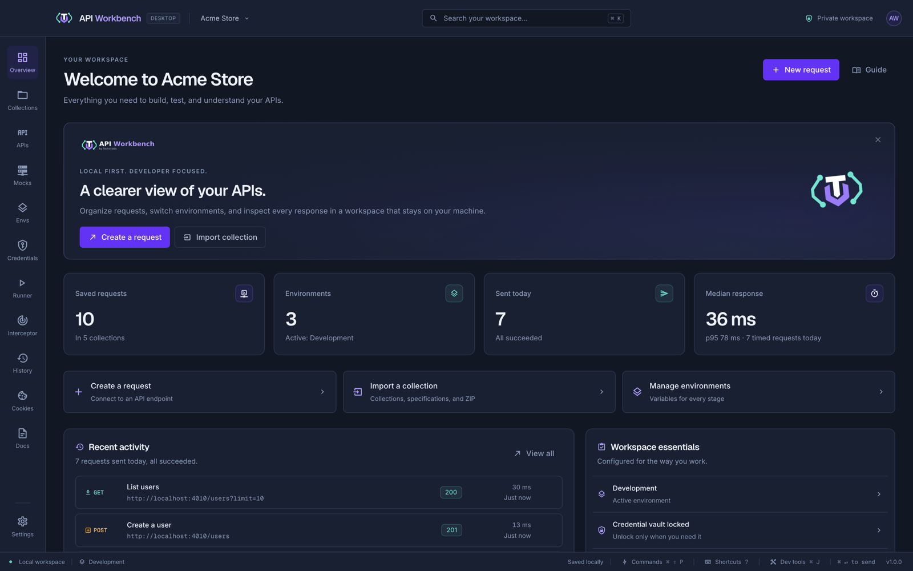
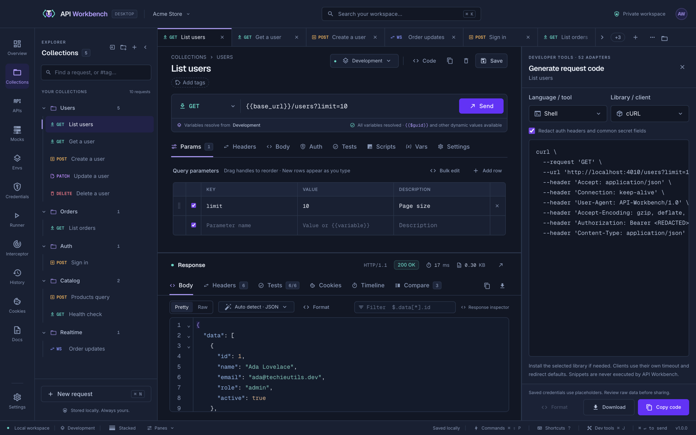
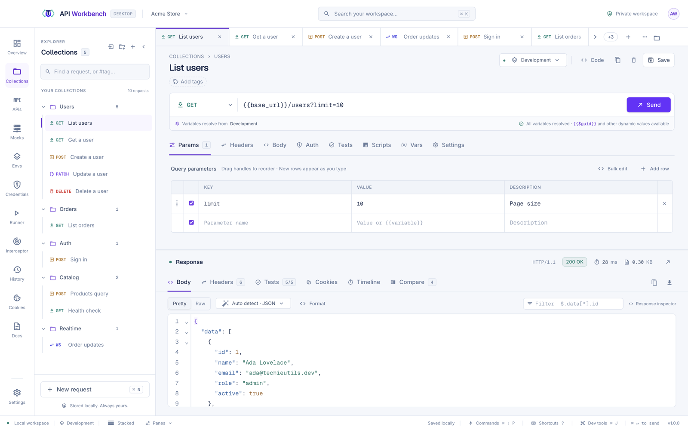

# The interface

| Area                | What it does                                                                                                                                    |
| ------------------- | ----------------------------------------------------------------------------------------------------------------------------------------------- |
| **Top bar**         | The current workspace (click to switch or manage workspaces), workspace search (<kbd>⌘/Ctrl</kbd>+<kbd>K</kbd>), and privacy status             |
| **Navigation rail** | Overview, Collections, APIs, Mocks, Environments, Credentials, Runner, Interceptor, History, Cookies, Docs, and Settings                        |
| **Explorer**        | Your collections and requests, on the Collections screen. <kbd>⌘/Ctrl</kbd>+<kbd>B</kbd> hides it; drag its edge to resize it                   |
| **Tabs**            | Open requests. When they do not fit they scroll, and **+N** lists the hidden ones. The **⋯** menu closes groups of tabs and reopens closed ones |
| **Status bar**      | The active environment, layout and panel toggles, save state, [dev tools](dev-tools.md), the command palette, and keyboard shortcuts            |
| **Dev tools**       | Console, Network, Performance, and Terminal, in a panel that rises from the status bar — see [Dev tools](dev-tools.md)                          |

Click **Private workspace** at the right of the top bar to see what stays private: where this workspace's files live, how secrets are encrypted, what history and responses are kept, and what leaves the device. It links to the workspace folder, **Settings → Privacy**, and **Credentials**.

The **Overview** summarizes the workspace and offers quick actions: create a request, import a collection, or manage environments. Four tiles summarize the workspace — saved requests and how many collections hold them, environments and the active one, how many requests you have sent today and how many succeeded, and today's median and p95 response time — and each opens its screen. **Recent activity** lists your latest sends with how today went, and links to the rest of History; click one to see it in History with its response, or use its open icon to go to the request. **Workspace essentials** links to where each setting lives: the active environment, the credential vault, History, whether responses are saved (**Settings → Privacy**), and updates.

## Panels and layout

The request editor and the response viewer share the main area. From the status bar:

- **Stacked** or **Side by side** layout — or <kbd>⌘/Ctrl</kbd>+<kbd>\\</kbd>.
- **Panes** shows or hides the request, response, and **Code** panels. The console lives in [Dev tools](dev-tools.md).

Drag a divider to resize panels, or focus it and use the arrow keys; double-click resets it. In a narrow request pane, the method, URL, and **Send** stay on one row.

## Tabs

- Middle-click a tab to close it. <kbd>⌘/Ctrl</kbd>+<kbd>Shift</kbd>+<kbd>T</kbd> reopens the last one closed.
- Double-click a tab, or press <kbd>F2</kbd>, to rename its request in place.
- Drag tabs to reorder them, or focus one and press <kbd>Alt</kbd>+<kbd>←</kbd> / <kbd>→</kbd>.
- Right-click a tab for **Rename**, **Close tab**, **Close other tabs**, **Close tabs to the right**, and **Close all tabs**.
- The **⋯** menu after the tabs closes the active tab, other tabs, or tabs to either side; moves between tabs; and lists recently opened and closed requests.
- Closing a tab never deletes its request.

## Context menus

Right-click almost anything for the actions that apply to it — or focus it and press <kbd>Shift</kbd>+<kbd>F10</kbd> or the menu key. Menus are on request and terminal tabs, explorer rows (collections, folders, and requests), history, environment, credential, cookie, runner, interceptor, network, API, and mock rows, key–value table rows, console entries, and protocol messages. Every editor — request and response bodies, tests, proto schemas, generated code, specifications — has **Undo**, **Redo**, **Cut**, **Copy**, **Paste**, and **Select all**, plus **Format** where the content can be formatted.

## Rows that scroll

When a row of tabs, filters, or chips is wider than its space — request and response tabs, toolbars, settings sections, runner modes, filters — arrows appear at the ends that are cut off. Click one to scroll, or use the trackpad or mouse wheel. The arrows only appear while something is actually hidden.

## Icons

Select boxes, lists, and tabs show an icon beside each choice: methods and protocols, auth types, languages, environments, credentials, cookies, settings sections, and more, so a choice can be recognised at a glance.

## Themes and density

**Settings → Appearance** switches between the dark **Navy** theme, the light **Pearl** theme, or your system's choice, and between comfortable and compact density.

## Find anything

- <kbd>⌘/Ctrl</kbd>+<kbd>K</kbd> searches requests, collections, and environments.
- <kbd>⌘/Ctrl</kbd>+<kbd>Shift</kbd>+<kbd>P</kbd> opens the command palette.
- <kbd>?</kbd> opens every keyboard shortcut. See [Shortcuts](shortcuts.md).
