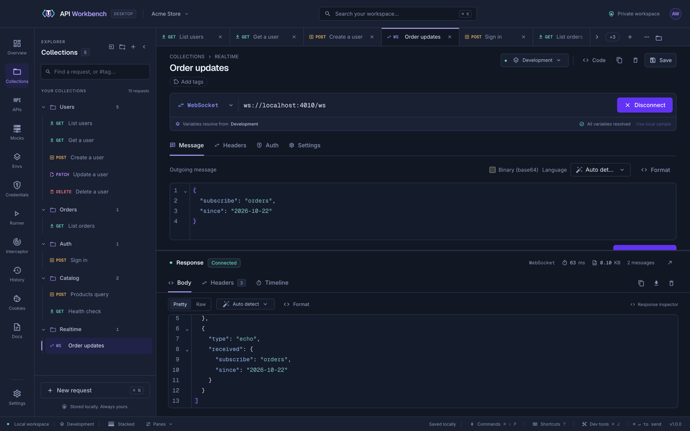

# Realtime protocols

The request editor handles realtime APIs too. Choose the type in the first box of the URL bar: an HTTP method under **HTTP · REST and GraphQL**, or **WebSocket**, **SSE**, **NDJSON**, **gRPC**, **Socket.IO**, or **MQTT** under **Live protocols**.



```cards
- title: WebSocket
  icon: swap-horizontal
  href: websocket.md
  text: Send and receive text and binary frames.
- title: Server-Sent Events
  icon: broadcast
  href: sse.md
  text: Follow an event stream as it arrives.
- title: NDJSON
  icon: format-list-bulleted
  href: ndjson.md
  text: Read newline-delimited JSON streams.
- title: gRPC
  icon: lan-connect
  href: grpc.md
  text: Unary and every kind of streaming call.
- title: Socket.IO
  icon: lightning-bolt-outline
  href: socketio.md
  text: Emit named events and read acknowledgements.
- title: MQTT
  icon: access-point-network
  href: mqtt.md
  text: Subscribe to topics and publish with QoS.
```

## How live requests work

Live requests have **Message** (with **Schema** for gRPC and **Topics** for MQTT), **Headers** (or **Metadata**), **Auth**, and **Settings** tabs, and share the response viewer:

- **Pretty** combines JSON messages into an array; **Raw** shows each message as received.
- **Timeline** marks every message sent and received, with timings and byte counts.

They use the same [authorization](authentication.md) as HTTP — including saved credentials and OAuth 2.0 — the same [proxy settings](settings.md#proxy), and [client certificates](client-certificates.md) for `wss://`, HTTPS streams, TLS gRPC, and `mqtts://`. **Code** generates a client for each protocol — see [Code snippets](code-snippets.md#realtime-protocols).

## Limits

- Connections stay open while you switch tabs. Closing the tab, deleting the request, changing its type, or quitting disconnects it.
- The default session timeout is five minutes; set 100 ms to one hour in the request's **Settings**.
- Up to ten sessions can be open at once. Messages are limited to 1 MiB, and the viewer keeps the latest 500.

> [!TIP]
> Try every protocol locally with the bundled [protocol playground](../examples/protocol-playground/README.md), or click **Use local sample** in a live request.
