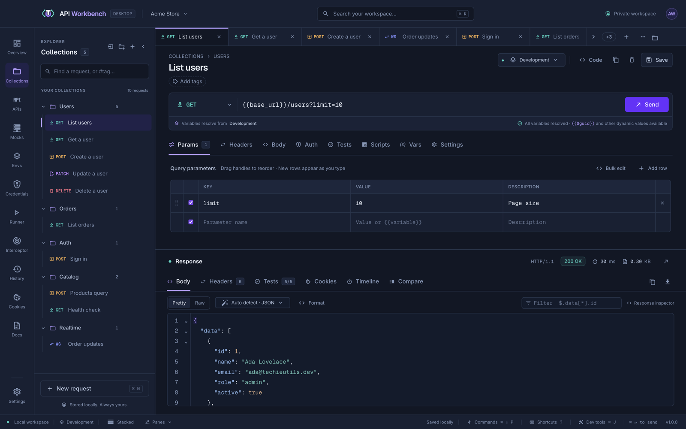
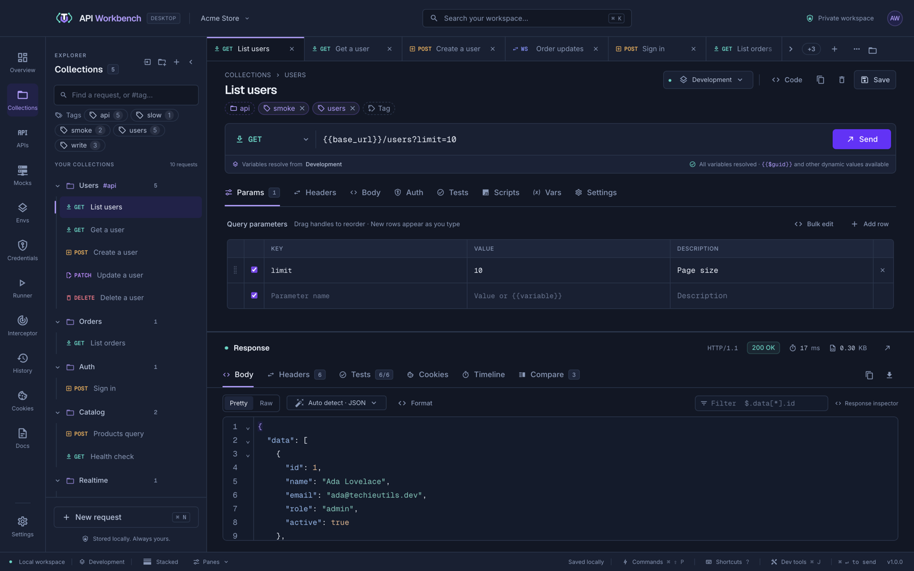
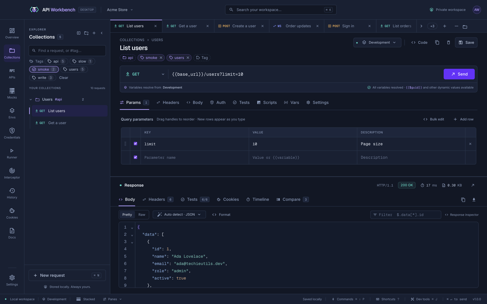
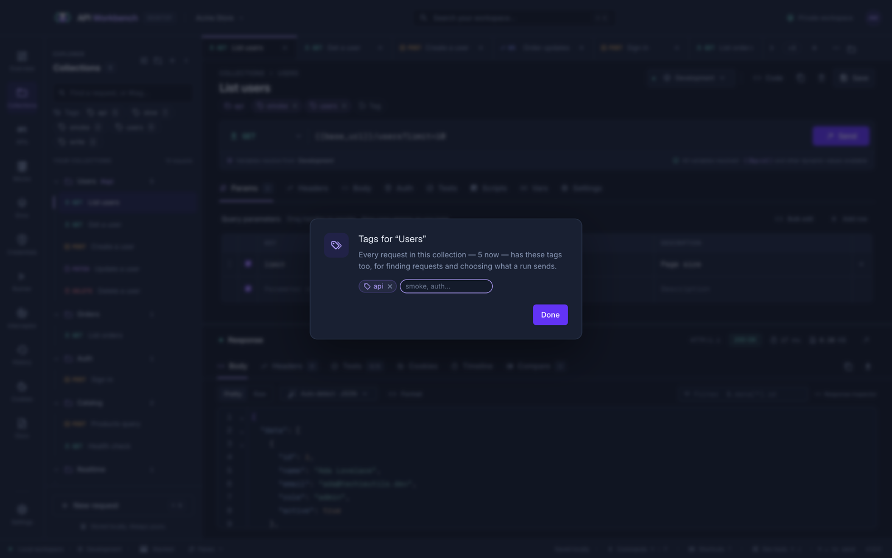
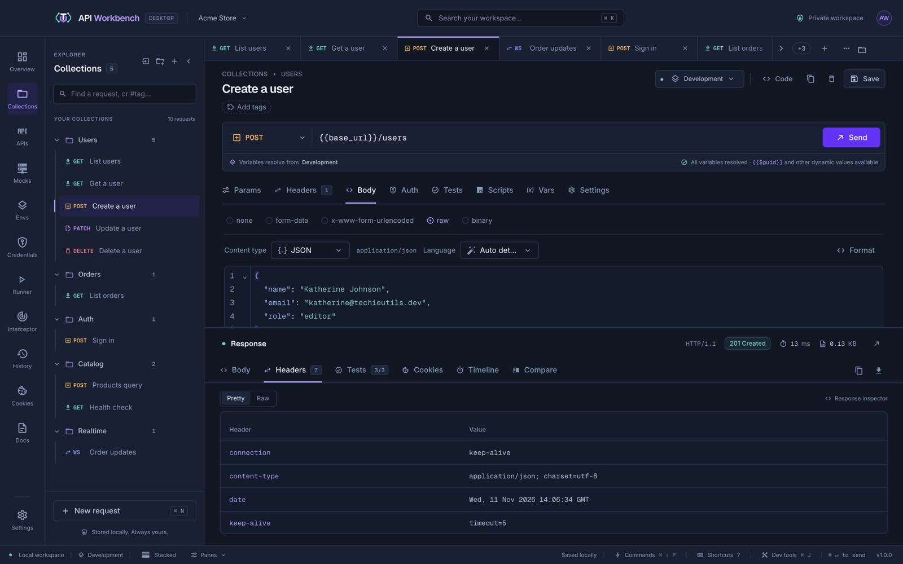

# Creating requests



## The request editor

The heading shows the collection and the request name. To its right are the environment picker, **Code**, duplicate, delete, and **Save**.

The first box in the URL bar sets what the request is. Under **HTTP · REST and GraphQL** it lists the methods — GET, POST, PUT, PATCH, DELETE, HEAD, OPTIONS, TRACE, and CONNECT ([how TRACE and CONNECT are sent](rest-graphql.md#trace-and-connect)) — each with a line on what it is for; under **Live protocols** it lists WebSocket, SSE, NDJSON, gRPC, Socket.IO, and MQTT (see [Protocols](live-protocols.md)). Choosing a method makes the request HTTP with that method, and the box shows it in the method's colour.

Under the URL bar, a line confirms which environment the variables resolve from and flags any that do not. Query parameters typed in the URL appear in **Params**, and edits in either place stay in sync.

## Tags

Tags are short labels on a request, such as `smoke`, `auth`, or `slow`. Use them to find requests and to choose what a [collection run](runner.md#run-by-tag) sends — a quick smoke test, only the write requests, everything but the slow ones.



- **Add tags:** click **Add tags** (or **Tag**) under the request's name, type one or several separated by commas or spaces, and press <kbd>Enter</kbd>. Tags already used in the workspace are suggested as you type.
- **Remove a tag:** click the **×** on it, or press <kbd>Backspace</kbd> in an empty tag field to remove the last one.
- **Find by tag:** under the explorer's search, the **Tags** bar lists every tag in the workspace with how many requests have it. Click a tag to show only requests with it, again to hide them instead, and again to stop filtering; with several shown, **Any tag** or **All tags** decides whether a request needs one or all of them. The bar works with the search, and **Clear** removes its filter. The search matches tags too: type `#smoke` for requests tagged exactly `smoke`.



### Collection and folder tags

A collection or folder can have tags too, and every request inside it has them as well — tag the **Orders** collection `orders` once instead of each request in it. Open a collection's or folder's menu (**⋯** or right-click) and choose **Tags…**; add and remove its tags in the dialog, then click **Done**. Changes are saved as you make them.



- The explorer shows a collection's and folder's own tags beside its name, such as **Users #api**.
- A request shows the tags it has from its collection and folders first, with a folder icon and a dashed border. Point at one to see where it comes from; it is changed there, not on the request.
- A request's own tags come after them. Adding one it already has from above says where it comes from, and is not added twice.
- Search, [runs](runner.md#run-by-tag), and the [command line](cli.md#run-tests) all use a request's own tags together with its collection's and folders'.

A tag starts with a letter or digit and can use letters, digits, `-`, `_`, `.`, `:`, and `/` — for example `p0`, `team:payments`, or `api/v2` — up to 40 characters, with no spaces. Tags ignore case: `Smoke` and `smoke` are one tag, and a request keeps the spelling it was given. A request can have up to 20.

A collection's or folder's tags are saved in its `_collection.yaml` or `_folder.yaml`, and move, rename, duplicate, export, and delete with it. A request's tags are saved in its YAML file. Both are shared in [team workspaces](team-workspaces.md) and kept by exports in API Workbench's own format:

```yaml
tags:
  - smoke
  - users
```

## Request tabs

| Tab          | Use it to                                                                                                                                                       |
| ------------ | --------------------------------------------------------------------------------------------------------------------------------------------------------------- |
| **Params**   | Edit query parameters, each with an optional description.                                                                                                       |
| **Headers**  | Add headers, with suggestions for more than 50 common names. Automatic headers (Accept, User-Agent, and others) sit under the eye toggle and can be overridden. |
| **Body**     | Choose none, form-data, x-www-form-urlencoded, raw, or binary.                                                                                                  |
| **Auth**     | Choose how the request authenticates — see [Authorization](authentication.md).                                                                                  |
| **Tests**    | Assertions that run on every send — see [Tests](tests.md).                                                                                                      |
| **Vars**     | Capture response values into variables — see [Environments](variables.md#capture-values-from-responses).                                                        |
| **Settings** | Override timeouts, redirects, TLS, HTTP version, proxy, and connections — see [Settings](settings.md#http-settings).                                            |

Tables add a new row as you type. Drag a row's handle — or focus it and use the arrow keys — to reorder. **Bulk edit** switches to one `Key: Value` per line; prefix a line with `// ` to disable it.

## Bodies



| Body type                 | What it sends                                                                                                                                                                                |
| ------------------------- | -------------------------------------------------------------------------------------------------------------------------------------------------------------------------------------------- |
| **Raw**                   | JSON, text, XML, HTML, JavaScript, GraphQL, CSV, YAML, JSON:API, NDJSON, or any custom MIME type. **Content type** sets what is sent; **Language** only changes highlighting and formatting. |
| **form-data**             | Text or file fields; keys may repeat. Multipart boundaries are generated for you.                                                                                                            |
| **x-www-form-urlencoded** | Fields encoded with the correct content type.                                                                                                                                                |
| **Binary**                | A file's bytes as the body.                                                                                                                                                                  |

> [!NOTE]
> File uploads are limited to 20 MB per file and stay in memory, so reselect them after restarting the app. GET and HEAD requests never send a body.

## Editors

Body editors highlight syntax, fold, match brackets, search (<kbd>⌘/Ctrl</kbd>+<kbd>F</kbd>), and **Format** (<kbd>Shift</kbd>+<kbd>Alt</kbd>+<kbd>F</kbd>) JSON, XML, HTML, CSS, YAML, GraphQL, Markdown, JavaScript, and TypeScript. Large JSON numbers are kept exactly.

## Variables everywhere

Any field accepts `{{variables}}` from the active environment and dynamic values such as `{{$guid}}` — see [Environments and variables](environments.md).

## Related

```cards
- title: Responses
  icon: file-document-outline
  href: responses.md
  text: Previews, headers, timing, certificates, and comparisons.
- title: Code snippets
  icon: code-tags
  href: code-snippets.md
  text: Turn the request into code in 26 languages.
```
