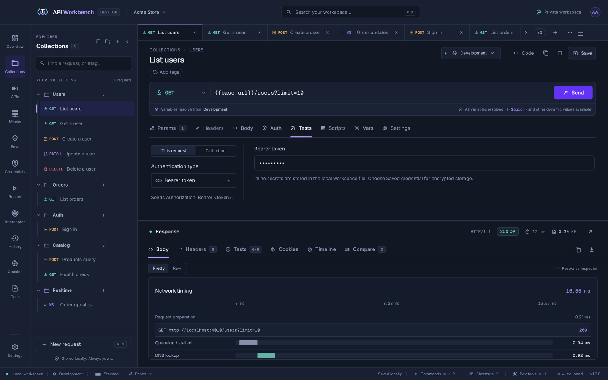

# Responses

The response header shows the HTTP version, status, total time, and size.

## Response tabs

| Tab             | Shows                                                                                                                                                   |
| --------------- | ------------------------------------------------------------------------------------------------------------------------------------------------------- |
| **Body**        | The body, formatted in **Pretty** or exactly as received in **Raw**. Filter JSON with a path such as `$.data[*].id` or `$.users[?(@.role == "admin")]`. |
| **Headers**     | Response headers as a table, or raw header lines.                                                                                                       |
| **Tests**       | Assertion results — see [Tests](tests.md).                                                                                                              |
| **Cookies**     | Cookies the response set.                                                                                                                               |
| **Timeline**    | Where the time went.                                                                                                                                    |
| **Compare**     | Differences from an earlier response.                                                                                                                   |
| **Certificate** | For HTTPS: the certificate chain, validity, SANs, fingerprints, TLS version, and cipher, with PEM downloads.                                            |

## Pretty previews

In **Pretty**, the body is shown by its content type:

| Content type                                       | Pretty shows                                                                                                                                                                                                                 |
| -------------------------------------------------- | ---------------------------------------------------------------------------------------------------------------------------------------------------------------------------------------------------------------------------- |
| JSON, XML, text, YAML, CSV, and other text         | Formatted, highlighted text, with the JSON filter                                                                                                                                                                            |
| Images (PNG, JPEG, GIF, WebP, AVIF, SVG, BMP, ICO) | The image and its dimensions, fit to the pane or at actual size                                                                                                                                                              |
| `application/pdf`                                  | The PDF in a viewer                                                                                                                                                                                                          |
| Audio and video                                    | A player                                                                                                                                                                                                                     |
| Fonts (WOFF, WOFF2, TTF, OTF)                      | Sample text in the font                                                                                                                                                                                                      |
| `text/html`                                        | The rendered page in a sandbox with scripts removed — or **Source** for the markup                                                                                                                                           |
| `text/markdown`                                    | The rendered document in the app's theme — or **Source** for the Markdown. Embedded HTML shows as text, images show their description, and web and mail links open in your browser or mail app after you confirm the address |
| Other binary data                                  | Its first 256 bytes as hex                                                                                                                                                                                                   |
| `application/octet-stream`                         | The body as text, without a preview                                                                                                                                                                                          |

A response without a Content-Type is recognised by its first bytes, and **Raw** always shows the body as text.

When the body shows as text, the language box beside **Pretty**/**Raw** chooses how:

- **Auto detect** (the default) picks the language from the Content-Type, or from how the body starts when the type is missing or generic: JSON, NDJSON, HTML, XML, YAML, a shell script, or Markdown. It names what it picked, and shows **Raw** when it cannot tell.
- **Raw** shows the text as received, with no highlighting.
- **Hex** shows the bytes as a hex dump with offsets and printable characters, up to the first 1 MB.
- **Base64** shows the bytes encoded as Base64.
- Any language, such as JSON, XML, or SQL, highlights the body as that language.

**Copy** copies what a Hex or Base64 view shows; **Download** always saves the original body. The JSON filter is hidden in the Hex and Base64 views.

> [!NOTE]
> Previews use the original bytes, kept for bodies up to 25 MB and never saved with the workspace. Binary bodies download as their original bytes with a matching file extension.

## Network timing

**Timeline** is a waterfall of the real connection: preparation, queueing, DNS lookup, TCP connect, TLS handshake, sending, waiting for the first byte, and downloading. Redirects get their own rows, and reused connections skip the setup phases. **Raw** shows the same measurements as JSON.

## Compare responses

**Compare** diffs this response against an earlier one of the same request — status, headers, and body — ignoring headers that change on every response, such as `Date`. Pin a response to compare later ones against it.

## Capture from a response

Right-click almost anything in a response to save it into a variable for later requests — see [Capture values from responses](variables.md#capture-values-from-responses):

| Tab             | Right-click                                                          | Captures                                       |
| --------------- | -------------------------------------------------------------------- | ---------------------------------------------- |
| **Body**        | A JSON value or key, or selected text                                | `$.path`, or `between "…" "…"`                 |
| **Preview**     | An HTML element, the page's title or meta content, or selected text  | `html <selector> [@attribute]`, or `between …` |
| **Headers**     | A header row, a cookie of the `set-cookie` row, or a line of **Raw** | `header <name>`, `cookie <name>`               |
| **Cookies**     | A cookie                                                             | `cookie <name>`                                |
| **Tests**       | A result                                                             | The value its assertion checks                 |
| **Timeline**    | The total or a phase                                                 | `timing <phase>`                               |
| **Compare**     | A JSON line, a changed header, or the status, time, or size          | `$.path`, `header <name>`, `status`, …         |
| **Certificate** | A field of the connection or a certificate                           | `certificate <field>`                          |

[History](history.md) offers the same for the responses it kept, and for a failed request's error.

## Copy, download, and layout

- **Copy** and **Download** export the active tab; PNG images copy as images.
- Maximize the response with <kbd>⌘/Ctrl</kbd>+<kbd>Shift</kbd>+<kbd>M</kbd>, and switch between stacked and side-by-side layouts from the status bar.
