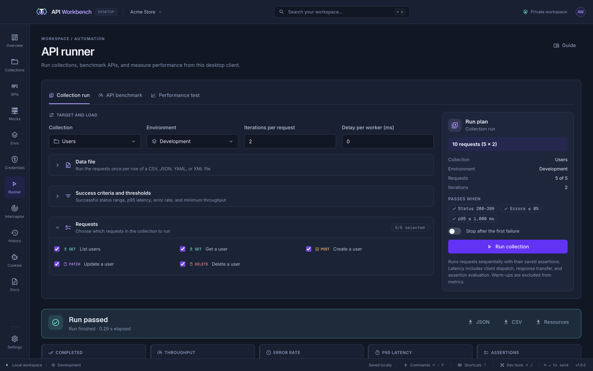
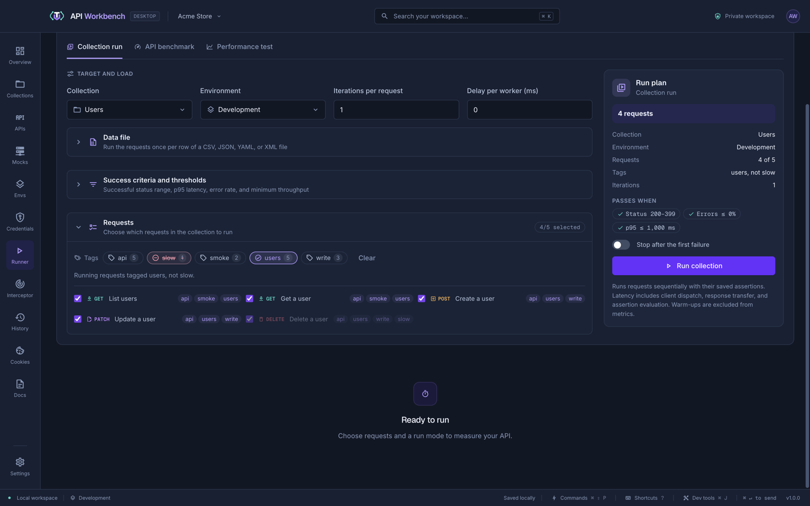
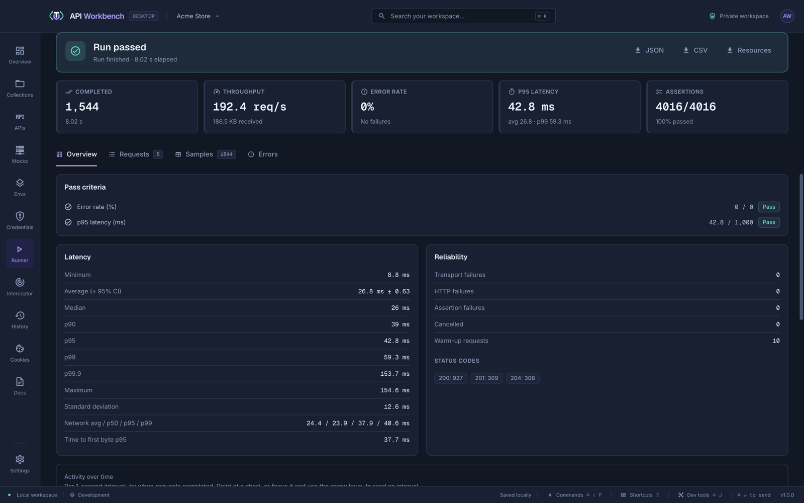
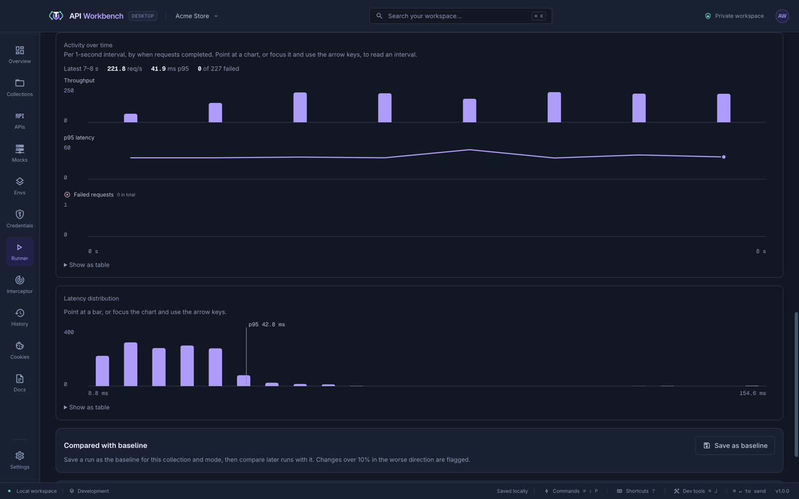

# Runner, benchmarks, and performance tests

The **Runner** runs a collection's requests with their tests, measures how fast an API responds, and puts it under sustained load.



## Run a collection

1. Open **Runner**.
2. Choose a **Run mode**, the **Collection**, and the **Environment**.
3. Under **Requests**, select which ones to include.
4. Check the **Run plan** beside the form, then click **Run collection** (or **Start benchmark** / **Start performance test**) at its foot.

The **Run plan** stays in view as you scroll the form. It says how many requests the run sends (for example _10 requests (5 × 2)_, or _Up to 10,000 measured requests_ for a performance test), the collection, environment, iterations or duration, workers or target rate, and warm-ups, and lists what the run **Passes when**: the status range, the error rate, and any p95 or throughput limit. **Stop after the first failure** is a switch there. While the run goes, a progress bar shows how far it has got, by requests or, for a performance test, by time.

Each run takes a snapshot of the selected requests and environment values when it starts, so editing during a run does not change it.

## Run by tag

When the collection's requests have [tags](requests.md#tags) — their own, or their collection's and folders' — the **Requests** panel lists them, each with how many requests have it. Click a tag to choose by it:

| Click | The tag                           | Shown as                     |
| ----- | --------------------------------- | ---------------------------- |
| Once  | Runs only requests with this tag  | A check, highlighted         |
| Twice | Leaves out requests with this tag | A minus sign, struck through |
| Again | No longer filters                 | Plain                        |



With more than one tag chosen, **Any tag** runs requests with at least one of them and **All tags** only requests with every one. A left-out tag always wins: a request tagged `smoke` and `slow` does not run when `slow` is left out. **Clear** removes the filter.

Tags work with the checkboxes: a request runs when it is checked and the tags choose it. Requests the tags leave out are dimmed, and the **Run plan** shows the filter, such as _Tags · users, not slow_, and how many requests that leaves. Reports record the filter too. A new collection starts without one.

## Run with a data file

A collection run can run once per row of a data file, for testing many inputs with one set of requests: users to create, IDs to look up, or cases with the result each should give.

1. In **Collection run**, open **Data file** and drop a CSV, JSON, YAML, or XML file on it, or click **Choose file…**.
2. Check the file card — its name, format, rows, columns, and size — and the **Columns**: each is shown as the variable it becomes, such as `{{id}}`, marked **Used ×1** (by how many of the selected requests) or **Not used**, so a column no request reads, or a misspelt variable, stands out. The preview shows the first rows.
3. Click **Run collection**. **Iterations** follows the number of rows.

**Replace…** chooses another file, and **Remove** goes back to a plain run.

Each row is one iteration: the selected requests run in order with that row's values. Use a column as `{{column}}` anywhere a variable works: the URL, parameters, headers, body, and auth. A column comes before an environment variable of the same name, for that iteration only.

Columns work in **Tests** too, so a row can say what it expects:

```text
id,name,expected_status
1,Ada,200
2,Sam,200
999,Nobody,404
```

```text
status {{expected_status}}
```

After the run, **Data rows** shows each row with its first columns, the responses in the successful status range, its assertions, and **Passed** or **Failed**. A row passes when its assertions pass, so a row may expect an error status; a request without tests passes when its status is in the successful range. The run's overall result still follows **Success criteria and thresholds**, so widen the status range if expected errors should not count against it. JSON reports include the data file's name, format, row count, and columns, but not its values.

| Format | What it needs                                                                                                                                                             |
| ------ | ------------------------------------------------------------------------------------------------------------------------------------------------------------------------- |
| CSV    | A header row of column names. Commas, semicolons, or tabs separate values; quote a value with `"` to include one, or a line break; `""` is a quote inside a quoted value. |
| JSON   | A list of objects, `[{ "id": 1 }, { "id": 2 }]`, or an object holding one such list.                                                                                      |
| YAML   | The same as JSON, written as YAML: a list of mappings.                                                                                                                    |
| XML    | Repeated elements inside the root, such as `<user>` inside `<users>`. Each one's attributes and child elements are its columns.                                           |

Numbers and `true`/`false` are used as written; nested objects and lists become JSON text; a value missing from a row is empty. Files are limited to 5 MB, 10,000 rows, and 200 columns, and the data file stays where it is: choose it again after editing it. Data files apply to collection runs only.

## Run modes

| Mode                 | What it does                                                                                                                                                                       |
| -------------------- | ---------------------------------------------------------------------------------------------------------------------------------------------------------------------------------- |
| **Collection run**   | Sends each request in order with its tests, for the number of iterations you set. Responses and history update as usual, and captured variables pass from one request to the next. |
| **API benchmark**    | Sends a fixed number of iterations per request with concurrent workers. Warm-up iterations run first and are left out of the results.                                              |
| **Performance test** | Keeps sending requests for a set duration, up to a maximum count.                                                                                                                  |

A performance test uses one of two load models:

- **Concurrent workers** — each worker sends its next request when the previous one finishes, ramping up gradually. A slower API receives less load, like a fixed pool of users.
- **Target request rate** — requests start on a fixed schedule (requests per second) whatever the API's latency, like real incoming traffic, with an optional ramp-up. If too many are already in flight, the extra starts are counted as **dropped**, so you see the saturation instead of a quietly lower rate.

Runs support 1–50 workers, up to 100,000 measured requests, and durations up to one hour. **Stop** cancels active requests. **Stop scheduling after a failure** stops new requests once one fails.

### Success criteria

Under **Success criteria and thresholds**, set which HTTP statuses count as success and the pass/fail limits for p95 latency, error rate, and minimum throughput. The run's result shows each threshold as passed or failed.

## Results



Results start with the **verdict** — _Run passed_, _Run failed_, _Run cancelled_, or _Run in progress_, with an icon and colour to match — and, when it failed, each criterion it missed with its value and limit. The report exports are beside it. Then five figures: **Completed**, **Throughput**, **Error rate**, **p95 latency**, and **Assertions**, each with a line of detail (failures, average and p99, KB received); a figure whose criterion failed is marked.

The rest is in tabs, each with its count:

| Tab           | Shows                                                                                                                                                                                                                                                                                     |
| ------------- | ----------------------------------------------------------------------------------------------------------------------------------------------------------------------------------------------------------------------------------------------------------------------------------------- |
| **Overview**  | **Pass criteria**; **Latency** (minimum to p99.9, the mean with its 95% confidence interval, standard deviation, network time, and time to first byte); **Reliability** (failures by kind, cancelled, warm-ups, and status codes); the charts; the baseline; and the app's CPU and memory |
| **Requests**  | Per-request statistics                                                                                                                                                                                                                                                                    |
| **Samples**   | The latest samples, filtered by result                                                                                                                                                                                                                                                    |
| **Data rows** | Each data row's outcome, in a data-driven run                                                                                                                                                                                                                                             |
| **Errors**    | Failures grouped by kind and message                                                                                                                                                                                                                                                      |

**Network time and time to first byte** are measured in the app's network layer, without the overhead of dispatching requests and checking tests, so you can tell the API's speed from the client's.



**Activity over time** charts throughput, p95 latency, and failures per second on a shared time axis. **Latency distribution** shows how response times spread, with the p95 marked. Point at a chart — or focus it and use the arrow keys — to read exact values, or open **Show as table**.

### Baselines

Click **Save as baseline** to keep a run's key metrics for its collection and mode. Later runs show the change in throughput, latency, network p95, and error rate, and flag any change of more than 10% in the worse direction as a regression.

### Reports

Export them with the buttons beside the verdict:

- **JSON** — the configuration, thresholds, timeline, grouped errors, and every measured sample.
- **CSV** — every measured sample, with its start offset, latency, network time, time to first byte, and any failure.
- **Resources** — the CPU and memory samples, as CSV.

Reports leave out request URLs, headers, bodies, responses, and environment values, so they are safe to share.

## What the numbers mean

The runner measures API Workbench's own HTTP client on your machine. Client latency includes dispatching the request, transferring the response, and checking tests; network time and time to first byte exclude them. Warm-ups are excluded from the statistics. Percentiles use the nearest-rank method. Cancelled requests are left out of the latency, error-rate, and throughput figures; completed failures are included.

For load tests aimed at production capacity, remember that a single desktop client is the load generator — its CPU and network limit how much load it can produce.

## From the command line

Run the same collection runs, benchmarks, and performance tests from a terminal or CI pipeline with `api-workbench run`, which fails the build on a missed threshold. `--tag smoke` and `--exclude-tag slow` choose requests by tag, as the Runner does. See [Run tests](cli.md#run-tests) and [Load tests](cli.md#load-tests).
