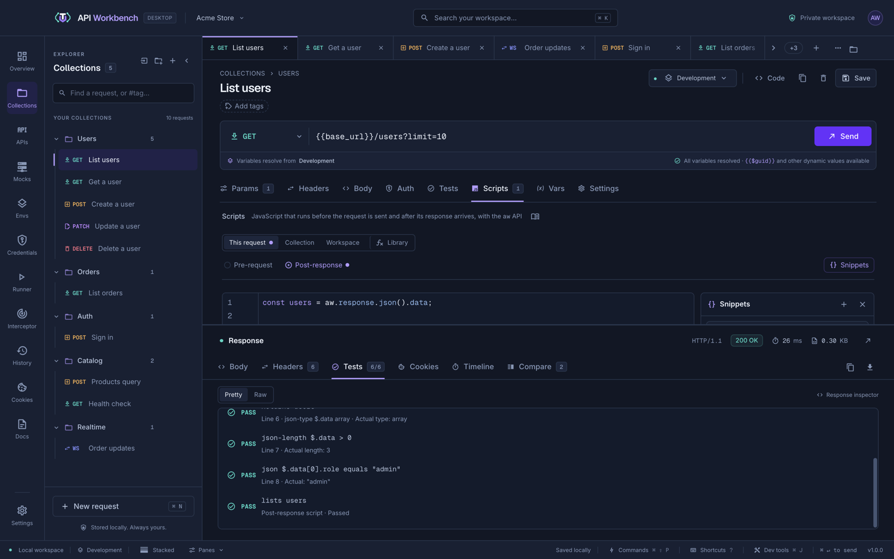
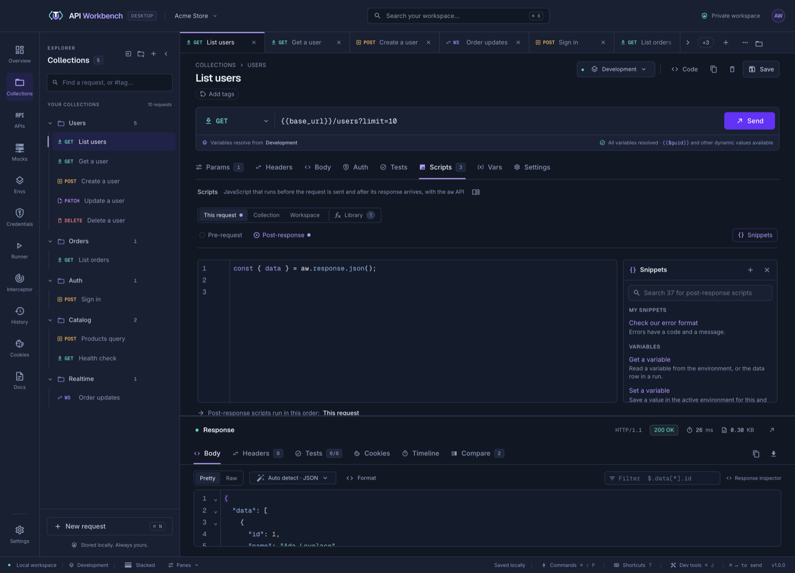
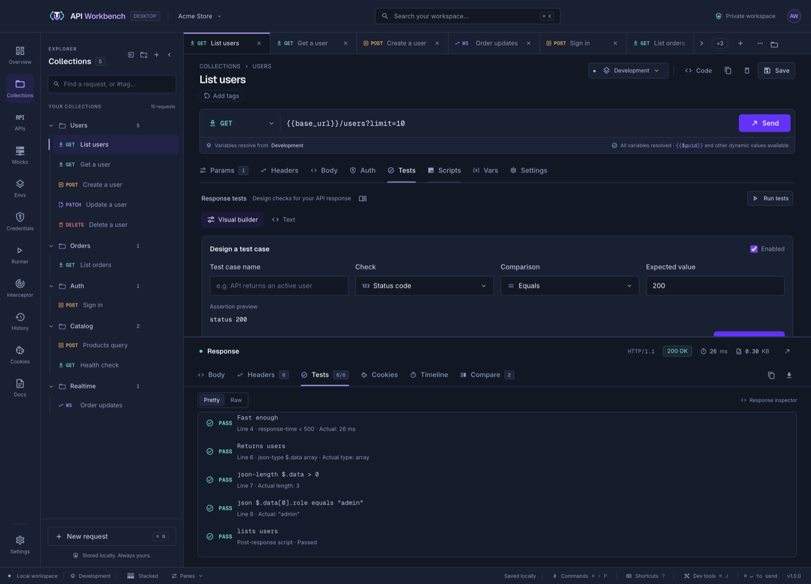
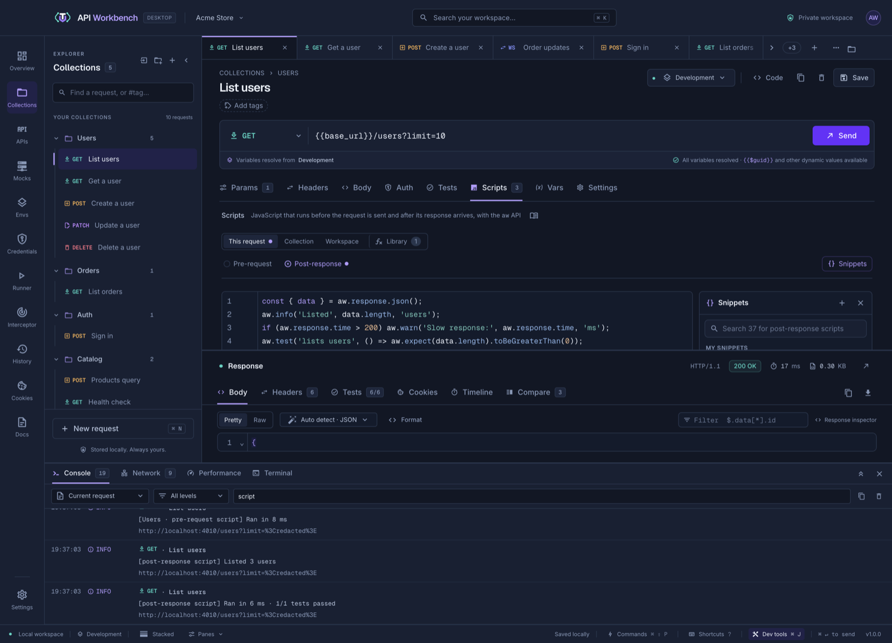
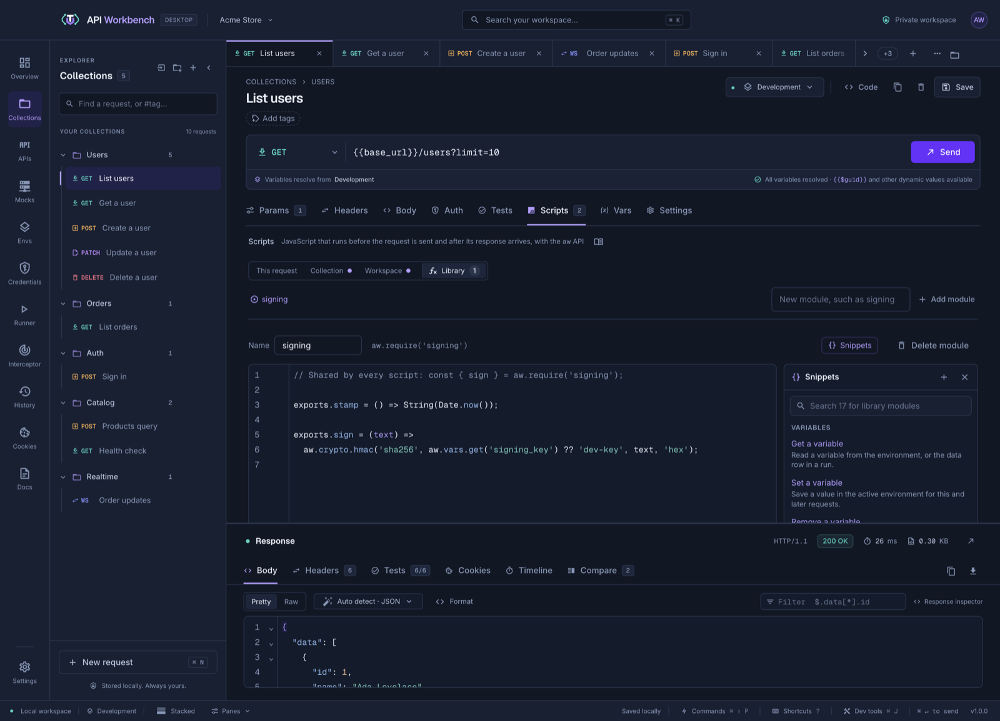
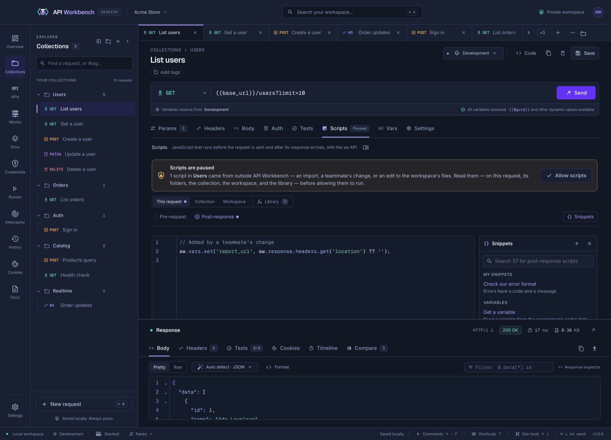

# Scripts



A request can run JavaScript at two points:

- **Pre-request**, before it is sent: set variables, add or change headers, change the URL, method, or body — for example, to sign the request.
- **Post-response**, after its response arrives: test the response and save values from it for later requests.

Open a request's **Scripts** tab, choose **Pre-request** or **Post-response**, and write the script. A dot beside a phase shows it has a script, and the tab counts them.

## Suggestions as you type

The script editor suggests the [`aw` API](#the-aw-api) as you type, as a code editor does. Type `aw.` for its members, and keep going — `aw.request.headers.`, `aw.expect(value).` — each suggestion shows its type or how it is called, and what it does beside the list. Choose one with <kbd>Enter</kbd> or <kbd>Tab</kbd>; a function is inserted with its parentheses, the cursor between them. <kbd>Ctrl</kbd>+<kbd>Space</kbd> shows suggestions where none opened, and <kbd>Esc</kbd> closes them.

Suggestions also come from what the editor knows about the request:

- **The last response:** after `aw.response.json().`, the keys of the request's last JSON response, all the way down (`aw.response.json().items[0].`), with what each holds. Send the request once to see them. A name you gave the body, as in `const body = aw.response.json();`, has them too.
- **Names you pass:** inside the quotes of `aw.vars.get('…')`, `set`, `has`, and `unset`, the active environment's variables; in `aw.require('…')`, the [library's](#script-library) modules; in `aw.request.headers.get('…')` and the response's, the header names; in `aw.crypto.hash('…')` and `hmac`, hash algorithms.
- **Your own names:** variables and functions declared earlier in the script.

Members that only work in the other phase, such as `aw.response` in a pre-request script, are listed last, and their description says where they work. Library modules run in both phases, so nothing is marked there.

## Syntax errors

The editor checks a script's syntax as you write it, without running it. A mistake — a missing bracket, a stray comma, a name declared twice — is underlined, with a mark beside its line; hover over it to see what is wrong. Under the editor, **Syntax error on line 3: Unexpected token** names it, and **Go to line 3** puts the cursor there. It goes away once the code parses again. <kbd>F8</kbd> moves to the error from anywhere in the editor.

A script with a syntax error fails before it runs, so its request is not sent; the check shows the same error the engine would, sooner. Library modules may use `return` outside a function, since each runs inside one.

## Snippets

The **Snippets** panel beside the editor lists ready-made code for what you are writing: pre-request snippets before sending, post-response snippets after, and module snippets in the [library](#script-library). Click one to insert it at the cursor, on a line of its own; type in the search box to find one by its name, description, or group. **Snippets** above the editor, or the panel's close button, shows and hides it.



| Group               | For example                                                                                 |
| ------------------- | ------------------------------------------------------------------------------------------- |
| Variables           | Get, set, or remove a variable; warn when one is missing; set one once                      |
| Request             | Set or remove a header, send a Bearer token, add a query parameter, change a JSON body      |
| Dynamic values      | Timestamp, ISO date, UUID, random number, nonce                                             |
| Response tests      | Status is 200 or a success, response time, headers, body text, JSON values and types, lists |
| Response values     | Save a JSON value or a header, read JSON safely, log the response                           |
| Crypto and encoding | HMAC signature of the body, SHA-256 and other hashes, Base64, a JWT's claims                |
| Logging             | Log a message, warn about a slow response, log a failed status                              |
| Library             | Use a library module, export a function, export shared checks                               |

Every built-in snippet is run by the test suite in each place it is offered, so inserting one never adds broken code; change its names and values to suit your API.

### Your own snippets

Save code you use often as a snippet of your own:

1. Select the code in the editor (or start with nothing selected), and click **+** at the top of the **Snippets** panel.
2. Give it a **Title**, and optionally a **Description**. Under **Use in**, choose where it is offered: **Pre-request**, **Post-response**, **Library module**, or more than one. The **Code** starts as your selection.
3. Click **Save snippet**.

Your snippets are listed first, under **My snippets**, and search finds them like the others. Point at one to show **Edit** and **Delete**.

Snippets are saved with the workspace, in its `workspace.json` under `scriptSnippets` — in a [team workspace](team-workspaces.md), the shared one, so the whole team has them. Exporting the whole workspace keeps them; importing adds the ones it does not have. A snippet is only text until you insert it: what you insert becomes part of your script, and runs as one you wrote.

## Workspace, collection, and folder scripts

The workspace, each collection, and each folder in it can have their own pre-request and post-response scripts, which run for every request inside. Use them for what many requests share: signing every request to an API, setting a timestamp, or checking that every response is JSON.



In a request's **Scripts** tab, the row above the phases picks the level to edit: **This request**, each folder it is in, **Collection**, and **Workspace**. A dot marks a level with a script in the chosen phase. Below the editor, the tab lists the scripts that run for the request, in order.

Both phases run from the outside in: the workspace's script, the collection's, then each folder's down to the request's own folder, then the request's. Each one sees the variables and, before sending, the request as the scripts before it left them.

- Before sending, the first script that throws stops the others and the send. The error names where it came from, such as `Shop / Orders pre-request script failed: …`.
- After the response, every script runs, even after one fails, so one failed check does not hide the others. Their tests appear with the request's, labelled with where they came from, such as **Shop · Post-response script**.

Collection and folder scripts are saved in the folder's `_collection.yaml` or `_folder.yaml` under `scripts`, and move, duplicate, export, and delete with the folder. The workspace's scripts are saved in its `workspace.json` under `workspaceScripts` — in a [team workspace](team-workspaces.md), the shared one, so the whole team runs them. Exporting the whole workspace keeps them; exporting one collection leaves them out. Importing a workspace that has them brings them in only when yours has none.

For most checks, [assertions](tests.md) and [captures](variables.md#capture-values-from-responses) are shorter and need no code. Use a script when you need logic: a computed value, a signature, a check that depends on another one.

## The aw API

Every script gets one object, `aw`.

| In a script                                            | Does                                                                                                                                                                                                                                                                      |
| ------------------------------------------------------ | ------------------------------------------------------------------------------------------------------------------------------------------------------------------------------------------------------------------------------------------------------------------------- |
| `aw.vars.get(name)`                                    | The variable's value from the active environment (or the data row, in a run), or `undefined`                                                                                                                                                                              |
| `aw.vars.set(name, value)`                             | Sets a variable in the active environment. Objects and numbers are saved as JSON text                                                                                                                                                                                     |
| `aw.vars.unset(name)` · `has` · `toObject()`           | Removes a variable · checks for one · all of them                                                                                                                                                                                                                         |
| `aw.request.url` · `method` · `body`                   | The request as written, with `{{variables}}` still in it. In a pre-request script, assign to change them (the URL keeps its host)                                                                                                                                         |
| `aw.request.headers.get/set/remove/has(name)`          | The request's enabled headers, by name in any case. `set` replaces a header or adds it                                                                                                                                                                                    |
| `aw.request.name`                                      | The request's name                                                                                                                                                                                                                                                        |
| `aw.response.status` · `statusText`                    | Post-response only: the status                                                                                                                                                                                                                                            |
| `aw.response.json()` · `text()` · `body`               | The body, parsed as JSON or as text                                                                                                                                                                                                                                       |
| `aw.response.headers.get(name)`                        | A response header, by name in any case                                                                                                                                                                                                                                    |
| `aw.response.time` · `size` · `url`                    | Time in milliseconds, size in bytes, and the final URL                                                                                                                                                                                                                    |
| `aw.test(name, () => { … })`                           | A named test: it passes unless the function throws. Results appear with the request's tests                                                                                                                                                                               |
| `aw.expect(value)`                                     | Checks: `toBe`, `toEqual`, `toContain`, `toMatch`, `toBeGreaterThan(OrEqual)`, `toBeLessThan(OrEqual)`, `toBeOneOf`, `toHaveLength`, `toHaveProperty(path, value?)`, `toBeTruthy`, `toBeFalsy`, `toBeDefined`, `toBeUndefined`, `toBeNull`. Put `.not` before any of them |
| `aw.assert(condition, message)`                        | Throws with the message when the condition is false                                                                                                                                                                                                                       |
| `aw.crypto.sha256(text, encoding?)`                    | A SHA-256 hash. Encodings are `hex` (the default), `base64`, and `base64url`                                                                                                                                                                                              |
| `aw.crypto.hash(algorithm, text, encoding?)`           | Any hash Node.js supports, such as `sha1`, `sha512`, or `md5`                                                                                                                                                                                                             |
| `aw.crypto.hmac(algorithm, key, text, encoding?)`      | An HMAC signature                                                                                                                                                                                                                                                         |
| `aw.crypto.randomBytes(size, encoding?)` · `aw.uuid()` | Random bytes (1–1024) · a random UUID                                                                                                                                                                                                                                     |
| `aw.base64.encode/decode(text)` · `btoa` · `atob`      | Base64 of UTF-8 text                                                                                                                                                                                                                                                      |
| `aw.log(…)` · `aw.info` · `aw.warn` · `aw.error`       | Writes to the [console](dev-tools.md#console) at that level, labelled with where the script comes from. Arguments are joined with spaces; objects are written as JSON. There is no `console` object                                                                       |
| `aw.require(name)`                                     | A [library module](#script-library)'s exports                                                                                                                                                                                                                             |

Scripts run synchronously: `aw.test` functions cannot be `async`, and there is no `fetch` or timer.



Each script also writes a summary line to the console when it ends: how long it ran, how many of its tests passed, and which variables it set. Filter the console by `script` to see only script lines.

## Script library

The library holds modules of functions that every script in the workspace can use — a signing routine, a date format, a set of shared checks — so they are written once instead of copied into each script.



Open any request's **Scripts** tab and choose **Library**. Type a name, such as `signing`, and click **Add module**; edit its code below. **Name** renames it, and **Delete module** removes it. A name starts with a letter, then letters, digits, `-`, or `_`.

A module shares what it exports, as Node.js modules do:

```javascript
// Library module "signing"
exports.sign = (text) => aw.crypto.hmac('sha256', aw.vars.get('signing_key'), text, 'hex');
exports.stamp = () => String(Date.now());
```

Load it in any script, at any level, with `aw.require`:

```javascript
const { sign, stamp } = aw.require('signing');
const timestamp = stamp();
aw.request.headers.set('X-Timestamp', timestamp);
aw.request.headers.set('X-Signature', sign(timestamp + aw.request.body));
```

- A module runs the first time a script requires it, and once per script: requiring it again gives the same exports, with the state they keep.
- A module can use `aw` — the same request, response, and variables as the script that required it — and can require other modules with `require('name')`. A cycle gives the exports so far, as Node.js does.
- An error inside a module names it and its line, such as `TypeError: … (library signing, line 3)`. A module with a syntax error fails only the scripts that require it.
- Modules are saved as `scripts/<name>.js` in the workspace's folder, so they can be reviewed in git and edited in any editor; a `.js` file added there with a valid name becomes a module.
- Exports and imports in API Workbench's own format carry the library. An import adds the modules whose names are new and keeps your own under the same name.

## Examples

Sign a request with HMAC, using a key kept in an environment variable:

```javascript
const timestamp = String(Date.now());
aw.vars.set('timestamp', timestamp);
const signature = aw.crypto.hmac(
  'sha256',
  aw.vars.get('signing_key'),
  timestamp + aw.request.body,
  'hex',
);
aw.request.headers.set('X-Timestamp', timestamp);
aw.request.headers.set('X-Signature', signature);
```

Test a response and keep a value for the next request:

```javascript
const order = aw.response.json();

aw.test('order is created', () => {
  aw.expect(aw.response.status).toBe(201);
  aw.expect(order).toHaveProperty('status', 'pending');
  aw.expect(order.items).not.toHaveLength(0);
});

aw.test('responds in under 500 ms', () => {
  aw.expect(aw.response.time).toBeLessThan(500);
});

aw.vars.set('order_id', order.id);
```

## When scripts run

Each send runs, in order:

1. The **pre-request scripts** — the workspace's, the collection's, its folders', then the request's. Variables they set resolve in this request. Their changes go into what is sent, not into the saved request.
2. The request is prepared and sent.
3. The request's **assertions**, then its **captures**.
4. The **post-response scripts**, in the same order, which see the values captures just stored. It does not run when the request fails without a response.

When a pre-request script throws, the request is not sent, and the response area shows the error with the line it happened on. When a post-response script throws, its tests so far still count, and a failed **Post-response script error** test explains why.

Scripts run on every send, and in [collection runs](runner.md) — with each iteration's data row in `aw.vars`. Load tests (Benchmark and Performance) send requests as they are prepared and do not run scripts.

## Scripts from somewhere else

A script can change what a request sends, so API Workbench runs only the scripts you have seen. A script you write in the app runs at once. A script that arrived another way — in an imported collection, in a teammate's change to a [team workspace](team-workspaces.md), or in an edit to the workspace's files — is **paused**:



- The **Scripts** tab says **Paused**, and explains where the scripts came from.
- Sending the request does not run the script: a paused pre-request script stops the send, and a paused post-response script shows as a failed test.

Read the scripts — on the request, on each level above it, and in the library — then click **Allow scripts**. That allows every paused script that runs for the collection's requests on this computer: its requests', its folders', its own, and the workspace's. A paused workspace, collection, or folder script pauses every request it runs for. A paused library module pauses only the scripts that require it, and the Library shows it as **Paused**. If a script changes outside the app again, it is paused again until you allow the new version; editing it in the app keeps it allowed.

Which scripts are allowed is kept in the app's [data folder](installation.md#where-your-data-is-stored), as SHA-256 fingerprints, never in a workspace — so a shared folder cannot mark its own scripts as allowed.

## What scripts can reach

Scripts run in [QuickJS](https://bellard.org/quickjs/), a separate JavaScript engine, in a process of their own — never in the app's window. A script sees only the request, the response, and the variables, copied in for it.

- **No files, network, or system:** there is no `require`, `process`, `fetch`, timer, or `console` — log with `aw.log`.
- **No secrets from the vault:** [saved credentials](credentials.md) are applied after the script runs, in the main process, and are never shown to it.
- **Not another host:** a pre-request script can change the path, query, headers, method, and body, but not where the request goes. If the request's resolved URL points at a different scheme, host, or port after its scripts run — whether a script assigned `aw.request.url` or set a variable the URL uses, such as `{{base_url}}` — it is not sent, and the error names both hosts. Set the host in the request's URL or its environment instead. This keeps an allowed script from sending the request, with its credentials and cookies, somewhere else.
- **Limits:** a script stops after 2 seconds or 64 MB of memory, and can be up to 256 KB long.

Environment variables are visible to scripts, as they are to every request. Keep secrets in the [vault](credentials.md), not in variables, when scripts from others run in your workspace.

## On the command line

Because scripts run code from the workspace, the [command line](cli.md) asks you to choose. A run whose requests have scripts stops with a reason until you add one of:

- `--allow-scripts` — run them, as the app does.
- `--skip-scripts` — run the requests without them.

```sh
node api-workbench-cli.cjs run ./api -e Staging --allow-scripts
```

The command line has no allow list: `--allow-scripts` runs every script in what you run, so use it with workspaces you trust, such as your own repository. What scripts log is printed under each request, and their tests are in the JSON and JUnit reports.

## Saved with the request

Scripts are saved in the request's YAML file under `scripts`, as `pre` and `post`, so they are reviewed in git like the rest of the request:

```yaml
scripts:
  pre: |
    aw.vars.set('timestamp', Date.now());
  post: |
    aw.test('status is 200', () => aw.expect(aw.response.status).toBe(200));
```

Exports in API Workbench's own format keep them. Scripts from Postman, Insomnia, Bruno, and Hoppscotch use those tools' own APIs and are not imported — rewrite them with `aw`.
