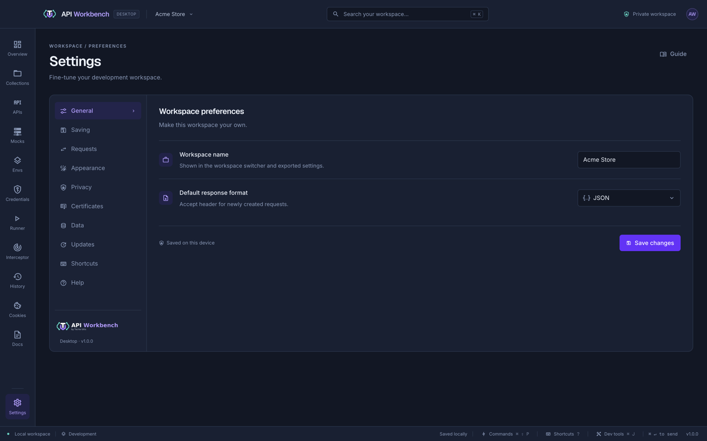
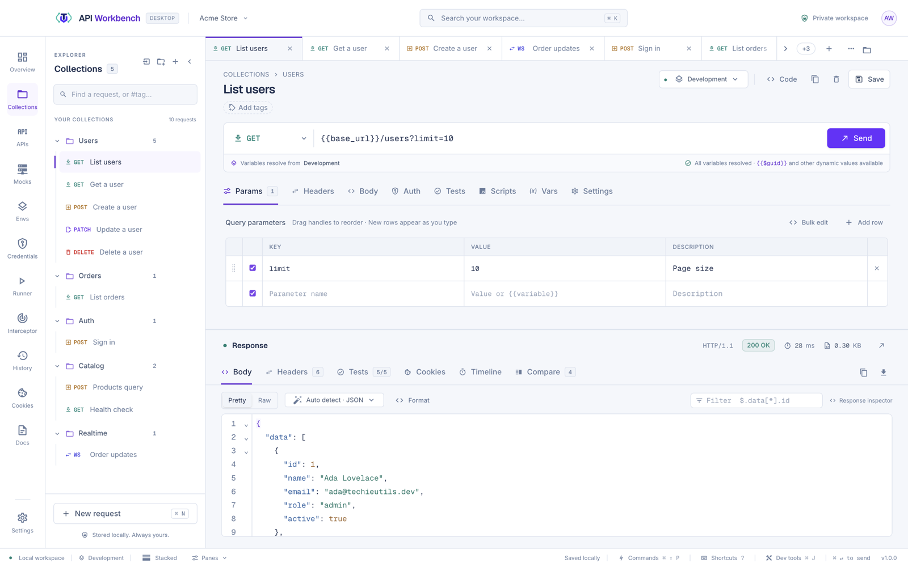
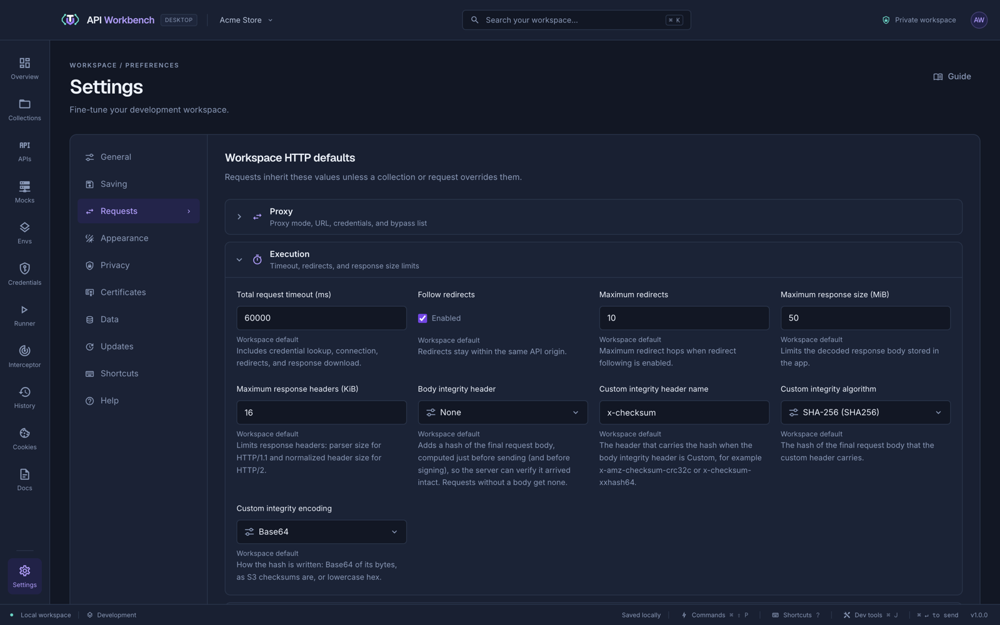

# Settings

Open **Settings** from the bottom of the navigation rail.

| Section          | Contains                                                                                                                                                                                                                                                                                                      |
| ---------------- | ------------------------------------------------------------------------------------------------------------------------------------------------------------------------------------------------------------------------------------------------------------------------------------------------------------- |
| **General**      | The workspace name and the default response format (the Accept header) for new requests                                                                                                                                                                                                                       |
| **Saving**       | Auto save (after every change, after a pause, or off), and the folder new workspaces are saved in — see [Saving](#saving)                                                                                                                                                                                     |
| **Requests**     | Workspace defaults for HTTP settings and proxies (below), in expandable Proxy, Execution, Connection, and TLS panels, plus a **Collection runs** panel for runner delay and stop on failure. A panel's badge counts the values changed from the defaults                                                      |
| **Appearance**   | Theme (dark, light, or system), density (comfortable or compact), response font size, and line wrapping                                                                                                                                                                                                       |
| **Privacy**      | Request history on or off and how many entries to keep, whether responses are saved, and clearing history                                                                                                                                                                                                     |
| **Certificates** | Client certificates in use (managed in Credentials) and the CA certificates this workspace trusts                                                                                                                                                                                                             |
| **Data**         | Import, and export in any format                                                                                                                                                                                                                                                                              |
| **Updates**      | How new versions arrive, pre-releases, and checking now — see [Updates](updates.md)                                                                                                                                                                                                                           |
| **Shortcuts**    | Every keyboard shortcut — see [Shortcuts](shortcuts.md)                                                                                                                                                                                                                                                       |
| **Help**         | Report a problem or request a feature on GitHub (the form opens with your version and system filled in), report a security vulnerability privately, copy your version and system, and open the documentation, troubleshooting, changelog, known issues, and the project on GitHub — see [Support](support.md) |

## Saving

**Auto save** decides when changes are written to disk:

| Choice                 | What happens                                                                                                                                                                                                                      |
| ---------------------- | --------------------------------------------------------------------------------------------------------------------------------------------------------------------------------------------------------------------------------- |
| **After every change** | The default: each change is saved as you make it.                                                                                                                                                                                 |
| **After a pause**      | Changes are saved together once you stop editing for **Pause before saving** seconds (1–60, 3 by default). The status bar says _Saving shortly…_ meanwhile.                                                                       |
| **Off**                | Nothing is saved until you press <kbd>⌘ S</kbd> (<kbd>Ctrl S</kbd>) or click **Unsaved changes** in the status bar. Closing the window asks **Save**, **Don’t save**, or **Cancel**, and switching workspaces asks to save first. |

Whatever the choice, changes still waiting are saved before the app closes, before you switch workspaces, and before Git sync. **Save changes** in Settings saves at once. Auto save is set per workspace, and new workspaces start with the current one's choice.

**Where workspaces are saved** shows the folder new workspaces go in, and the folder of the one that is open, with **Show in folder**. Without a folder of your own, they are saved in the app's data folder. **Choose folder…** picks one, such as `Documents/API Workbench`; **Use app data** goes back.

- Each new workspace gets a folder of its own there, named after it (`Shop API`, then `Shop API 2`), holding its workspace file and its collections, so it can be backed up, synced, or kept in Git like any folder.
- Workspaces already made stay where they are. When creating one, **Save in** in the workspace manager can also choose app data or another folder, just for that workspace.
- Credentials in the vault always stay in the app's data folder, encrypted by the system, wherever the workspace is.
- If the folder cannot be reached, such as an unplugged drive, Settings says so and new workspaces are saved in app data meanwhile.

## Updates

**Settings → Updates** shows your version and whether a newer one is out, and sets how updates arrive: **Ask before downloading** (the default), **Download and install automatically**, or **Only when I check**, with or without pre-releases. Changes apply as soon as you pick them. See [Updates](updates.md) for what each choice does, what a check sends, and troubleshooting.

## HTTP settings

HTTP settings can be set for the whole workspace (**Settings → Requests**), for a collection (its gear in the explorer), or for one request (its **Settings** tab). Each field inherits in this order:

**app defaults → workspace → collection → folders → request**

Turn on **Override** next to a field to change it at that level; other fields keep inheriting. Labels show where each value comes from, and **Reset overrides** restores inheritance.

| Setting        | Options                                                                                                                                                                                                                        |
| -------------- | ------------------------------------------------------------------------------------------------------------------------------------------------------------------------------------------------------------------------------ |
| Timeouts       | Total (100 ms – 5 min), connection, response headers, and body idle timeouts                                                                                                                                                   |
| HTTP version   | HTTP/1.1, automatic HTTP/2 with fallback, or HTTP/2 only                                                                                                                                                                       |
| Redirects      | Follow on or off, and the maximum (0–30). Redirects to another origin are always blocked to protect credentials.                                                                                                               |
| TLS            | Minimum and maximum version, ciphers, certificate verification, and a custom CA bundle                                                                                                                                         |
| Connections    | Reuse and keep-alive, per-origin pool size, pipelining, and connection rotation                                                                                                                                                |
| Limits         | Response header size and decoded body size (default 50 MiB)                                                                                                                                                                    |
| DNS            | Automatic, IPv4, or IPv6, and dual-stack connection attempts                                                                                                                                                                   |
| Body integrity | A hash of the request body in a header: Content-Digest, Digest, Content-MD5, S3 checksum presets, or a custom header name with CRC-32, CRC-32C, SHA-1, SHA-256, SHA-512, MD5, XXHash64, XXHash3, or XXHash128 in Base64 or hex |

## Proxy

Choose **HTTP(S) proxy** in **Settings → Requests → Proxy**, enter its URL (for example `http://localhost:8080`), and optionally a username and password. **Bypass proxy for** takes a comma-separated list such as `localhost, 127.0.0.1, .internal.example`; `*` bypasses everything.

Proxies follow the same workspace → collection → folder → request inheritance, and **Direct connection** turns an inherited proxy off. They apply to HTTP, GraphQL, SSE, NDJSON, and WebSocket requests; gRPC supports HTTP CONNECT proxies. A failed proxy never falls back to a direct connection. Proxy passwords are stored with your settings and left out of exports.
