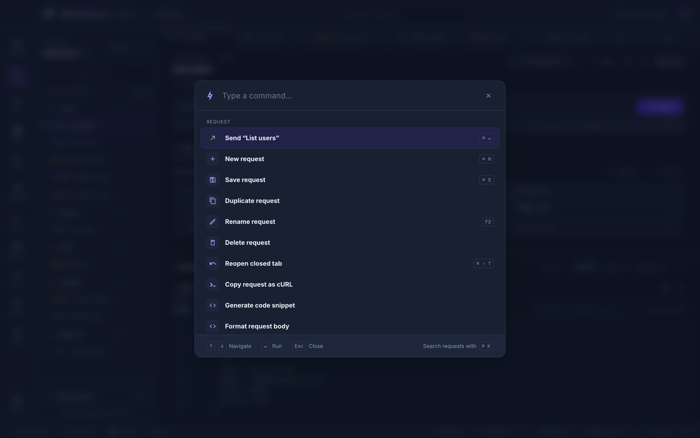
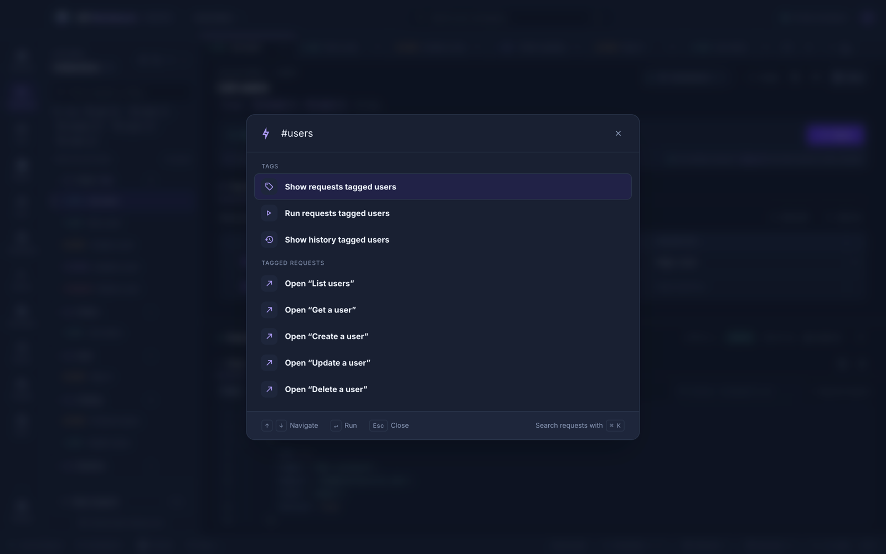
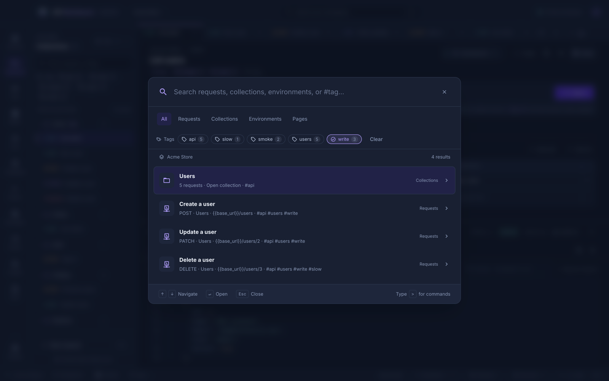

# Shortcuts

Press <kbd>?</kbd> anywhere outside a text field — or **Shortcuts** in the status bar — for a searchable sheet of every shortcut. On Windows and Linux, read <kbd>⌘</kbd> as <kbd>Ctrl</kbd>.

## Requests

| Shortcut                                     | Action                    |
| -------------------------------------------- | ------------------------- |
| <kbd>⌘</kbd>+<kbd>Enter</kbd>                | Send the request          |
| <kbd>⌘</kbd>+<kbd>N</kbd>                    | New request               |
| <kbd>⌘</kbd>+<kbd>S</kbd>                    | Save                      |
| <kbd>Shift</kbd>+<kbd>Alt</kbd>+<kbd>F</kbd> | Format the current editor |
| <kbd>⌘</kbd>+<kbd>F</kbd>                    | Search inside an editor   |

## Navigation

| Shortcut                                   | Action                     |
| ------------------------------------------ | -------------------------- |
| <kbd>⌘</kbd>+<kbd>K</kbd>                  | Search the workspace       |
| <kbd>⌘</kbd>+<kbd>Shift</kbd>+<kbd>P</kbd> | Command palette            |
| <kbd>?</kbd>                               | Keyboard shortcuts         |
| <kbd>⌘</kbd>+<kbd>Shift</kbd>+<kbd>T</kbd> | Reopen the last closed tab |
| Middle-click                               | Close a tab                |

## Collections

| Shortcut                                   | Action                                    |
| ------------------------------------------ | ----------------------------------------- |
| <kbd>F2</kbd>                              | Rename the selected request or collection |
| <kbd>Alt</kbd>+<kbd>←</kbd> / <kbd>→</kbd> | Move the focused request tab              |
| <kbd>Alt</kbd>+<kbd>↑</kbd> / <kbd>↓</kbd> | Move a request up or down                 |
| <kbd>⌘</kbd>+<kbd>B</kbd>                  | Show or hide the explorer                 |

## Panels

| Shortcut                                   | Action                                 |
| ------------------------------------------ | -------------------------------------- |
| <kbd>⌘</kbd>+<kbd>\\</kbd>                 | Stacked or side-by-side layout         |
| <kbd>⌘</kbd>+<kbd>J</kbd>                  | Show or hide [dev tools](dev-tools.md) |
| <kbd>⌘</kbd>+<kbd>Shift</kbd>+<kbd>M</kbd> | Maximize or restore the response       |

## Terminal

These work while the [terminal](dev-tools.md#terminal) has focus, in the panel or its own window.

| Shortcut                                                                        | Action                                             |
| ------------------------------------------------------------------------------- | -------------------------------------------------- |
| <kbd>⌘</kbd>+<kbd>\\</kbd>                                                      | Split the terminal right                           |
| <kbd>⌘</kbd>+<kbd>Shift</kbd>+<kbd>\\</kbd>                                     | Split the terminal down                            |
| <kbd>⌘</kbd>+<kbd>Alt</kbd>+<kbd>←</kbd> <kbd>→</kbd> <kbd>↑</kbd> <kbd>↓</kbd> | Focus the pane to the left, right, above, or below |
| <kbd>⌘</kbd>+<kbd>Shift</kbd>+<kbd>W</kbd>                                      | Close the focused pane                             |
| <kbd>Ctrl</kbd>+<kbd>Shift</kbd>+<kbd>`</kbd>                                   | Open a new terminal                                |
| <kbd>F2</kbd>                                                                   | Rename the selected terminal tab                   |
| <kbd>Alt</kbd>+<kbd>←</kbd> / <kbd>→</kbd>                                      | Move the selected terminal tab                     |

## Menus

| Shortcut                                                      | Action                                     |
| ------------------------------------------------------------- | ------------------------------------------ |
| Right-click, <kbd>Shift</kbd>+<kbd>F10</kbd>, or the menu key | Open the context menu for the focused item |
| <kbd>↑</kbd> / <kbd>↓</kbd>                                   | Move through menus and lists               |
| <kbd>Esc</kbd>                                                | Close a dialog or menu                     |

## Command palette

<kbd>⌘</kbd>+<kbd>Shift</kbd>+<kbd>P</kbd> runs any command by name — send, save, duplicate, rename, copy as cURL, generate code, format, switch environment, new collection, and more — with each command's shortcut beside it. Recently used commands come first.

### Tags in the palette

Type `#` and a [tag](requests.md#tags), such as `#smoke`, to list what you can do with it:

- **Show requests tagged smoke** — the explorer, filtered to them.
- **Run requests tagged smoke** — the Runner, with its tag filter set. It keeps the Runner's collection when that has the tag, and otherwise opens the first collection that does.
- **Show history tagged smoke** — History, filtered to what was sent from them.
- **Open “…”** — each request with the tag, including through its collection or folders.

A `#tag` matches a tag exactly, and other words narrow the list further: `#smoke list` finds the tagged requests with _list_ in their name. Words without `#` also find tags, so _smoke_ alone lists them too. **Clear tag filters** removes the tag filters of the explorer, History, and the Runner at once. These commands appear only once you type, so the full list stays short.

## Workspace search

<kbd>⌘</kbd>+<kbd>K</kbd> finds requests, collections, and environments by name, URL, or method. Pick a result to open it.

The **Tags** bar under the categories filters results by [tag](requests.md#tags): click a tag to show only what has it, again to hide it, and again to stop, with **Any tag** or **All tags** for several. Typing `#smoke` does the same for one tag. A request has its own tags and its collection's and folders'; a collection has its own and those of every request in it, so it is found when anything inside has the tag. Environments and pages have no tags, so a tag filter leaves them out. Each request's tags are shown after its URL.

