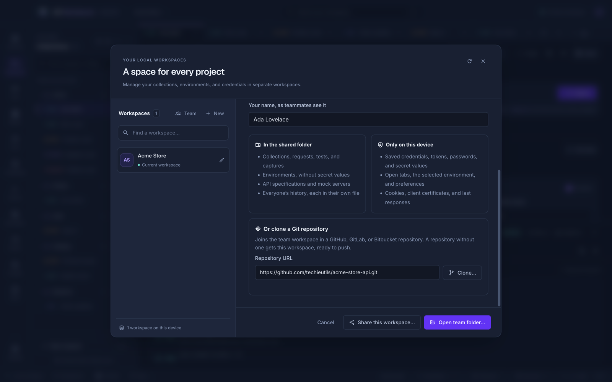
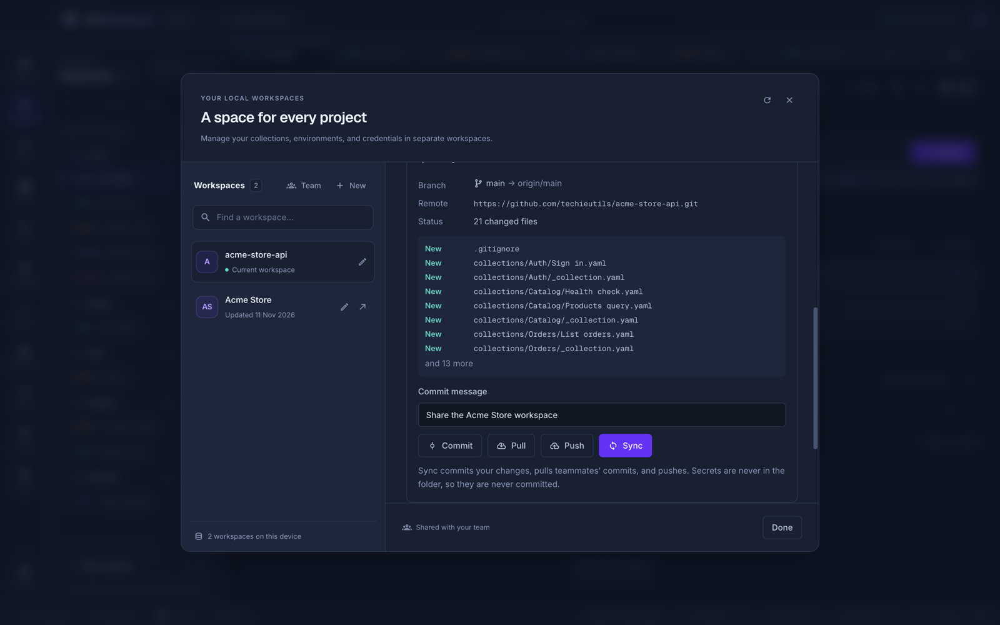

# Team workspaces

A team workspace lives in a folder everyone on the team can reach: a network drive, a folder synced by Dropbox, OneDrive, Google Drive, or iCloud, or a Git checkout. Everyone who opens the folder works on the same collections and environments, sees changes within seconds, and sees who else has it open. There is no account, server, or subscription.

## Share a workspace

1. Click the workspace name in the top bar, then **Team**.
2. Enter **Your name, as teammates see it**.
3. Click **Share this workspace…** and choose an empty folder in the shared location.

API Workbench copies the workspace into the folder and opens the copy. The original stays in your workspace list. Your saved credentials come with you, because the copy keeps your encrypted vault.

## Join a team workspace

1. Make sure the shared folder is on your computer: connect the network drive, let the sync app download it, or clone the repository (or let API Workbench clone it — see [Share through GitHub, GitLab, or Bitbucket](#share-through-github-gitlab-or-bitbucket)).
2. Click the workspace name in the top bar, then **Team**, and enter your name.
3. Click **Open team folder…** and choose the folder.

Choosing an empty folder with **Open team folder…** starts a new, blank team workspace there.

## Share through GitHub, GitLab, or Bitbucket

A team folder can be a Git repository. API Workbench commits, pulls, and pushes it for you, using the Git installed on your computer and the way it already signs in (an SSH key or your credential manager), so the app never asks for or stores a GitHub token. It works with GitHub, GitLab, Bitbucket, Azure DevOps, or any Git server.

**Start from a repository.** Create a repository on your Git host (an empty one is fine), then:

1. Click the workspace name in the top bar, then **Team**, and enter your name.
2. Under **Or clone a Git repository**, paste the repository's URL, such as `git@github.com:team/api.git` or `https://github.com/team/api.git`, and click **Clone…**.
3. Choose where to put the clone.



If the repository holds a team workspace, at its top or up to three folders down (such as `api/` in a service's repository), it opens. If not, the open workspace is shared into it, in an `api-workbench/` folder when the repository already has other files, named after the repository and ready to push.

**Connect a team folder you already have.** Open the team workspace, click its name in the top bar, and find **Git sync** under its details. Paste the repository URL and click **Connect and push**. A folder that is not yet in a repository becomes one.

**Sync.** **Git sync** shows the branch, the remote, and the changed files. Type a commit message (or leave the default) and click:



| Button     | What it does                                                        |
| ---------- | ------------------------------------------------------------------- |
| **Commit** | Commits the team folder's changes                                   |
| **Pull**   | Merges teammates' commits; the workspace reloads with their changes |
| **Push**   | Pushes your commits                                                 |
| **Sync**   | Commits, pulls, and pushes: the button to use most of the time      |

Only the team folder is committed. When it sits inside a code repository, your other changes there are left alone.

**Conflicts.** When you and a teammate changed the same file, the pull is undone, so nothing is left half-merged, and **Git sync** lists the files. Choose **Keep mine** or **Take theirs** for those files; changes to other files are merged either way. To merge by hand instead, choose **Decide later** and use Git in a terminal.

Things to know:

- Secrets are never in the team folder, so they are never committed. Remote URLs with a password or token in them (`https://user:token@…`) are refused; use your credential manager instead.
- `.workbench/`, where presence is kept, is added to the folder's `.gitignore` when **Git sync** first looks at the folder, so the `.gitignore` change is listed with your other changes.
- On a computer where Git has no user name and email, commits carry your team name.
- The repository's Git hooks do not run when the app commits, pulls, or pushes. Run Git in a terminal when your repository needs them.
- Git must be installed: [git-scm.com](https://git-scm.com/downloads). On macOS, Git from Homebrew or the Xcode command line tools works.
- The app does not pull on its own. Pull or sync when you start work, or teammates' changes wait in the repository.

## What is shared, and what stays on your device

| In the shared folder                                                 | Only on your device                                                                   |
| -------------------------------------------------------------------- | ------------------------------------------------------------------------------------- |
| Collections, folders, requests, tests, captures, and collection auth | Saved credentials and the [credential vault](credentials.md)                          |
| Environments and their variables                                     | Inline tokens and passwords, OAuth client secrets and refresh tokens, proxy passwords |
| API specifications and mock servers                                  | Values of secret-looking headers, query parameters, form fields, and variables        |
| Everyone's history, each person in their own file                    | Open tabs, the selected environment, and preferences                                  |
| Who has the workspace open, and the request they are on              | Cookies, client certificates, and the last response of each request                   |

A value counts as secret when its name contains `authorization`, `token`, `secret`, `password`, `api key`, `credential`, `cookie`, `private key`, or `session`, and it is typed in directly. A value made from variables, such as `Bearer {{token}}`, holds no secret, so it is shared, which lets teammates use the same request with their own `token` variable.

Teammates see an empty value where you typed a secret. Each person fills in their own, and it stays on their device. If a teammate replaces an empty value with something new, theirs is used.

> [!WARNING]
> Request bodies, URLs other than secret query values, and descriptions are shared as written. Keep secrets in variables or the vault, not in a body.

## Working together

- **Changes** save to the folder as you make them, and teammates' changes appear in your window within a few seconds. A notice names the requests that changed.
- **Who is here:** teammates with the workspace open appear as initials next to the workspace name. Hover to see the request each is on. When someone else has your request open, the request heading says so.
- **History** shows teammates' sends with their name. Your history limit counts only your own entries. **Clear history** and **Remove from history** affect only your own.
- With **Persist response bodies** on, your history's responses are saved in the shared folder, where teammates can read them. Secret-looking response headers and `Set-Cookie` values are left out.

Each request is its own file, and each environment is too, so two people editing different requests or environments never get in each other's way. If two people change the same request at the same moment, the version saved to the folder first is kept, and the other person's window reloads with it.

## Leave a team workspace

Switch to another workspace, open the team workspace's details, and choose **Leave team workspace**. This removes it from your device, along with your secrets and credentials for it. The shared folder and everyone else's copy stay as they are. Open the folder again to rejoin.

## The folder

```text
workspace.json            name, and the order of collections and environments
collections/              one folder per collection, one YAML file per request
environments/             one YAML file per environment
specs/  mocks/            API specifications and mock servers
history/<id>.json         each person's own history
.workbench/presence/      who has the workspace open (removed when they leave)
```

The files are plain text, so a Git repository works well: review changes in pull requests and keep the history of every request. Git sync adds `.workbench/` to `.gitignore`; add `history/` too if you do not want history committed. The [command line](cli.md) runs the same folder in CI.

> [!NOTE]
> Network drives and sync apps do not always report changes at once, so API Workbench also checks the folder every five seconds. A sync app's conflict copy of a file (such as `Create order (conflicted copy).yaml`) appears as an extra request; delete the one you do not want.

## From the command line

Every command takes a team folder with `--dir`, and `api-workbench team status`, `commit`, `pull`, `push`, and `sync` sync it with Git as the app does. To test it on every push, see [Run API tests in CI](guides/run-api-tests-in-ci.md).
