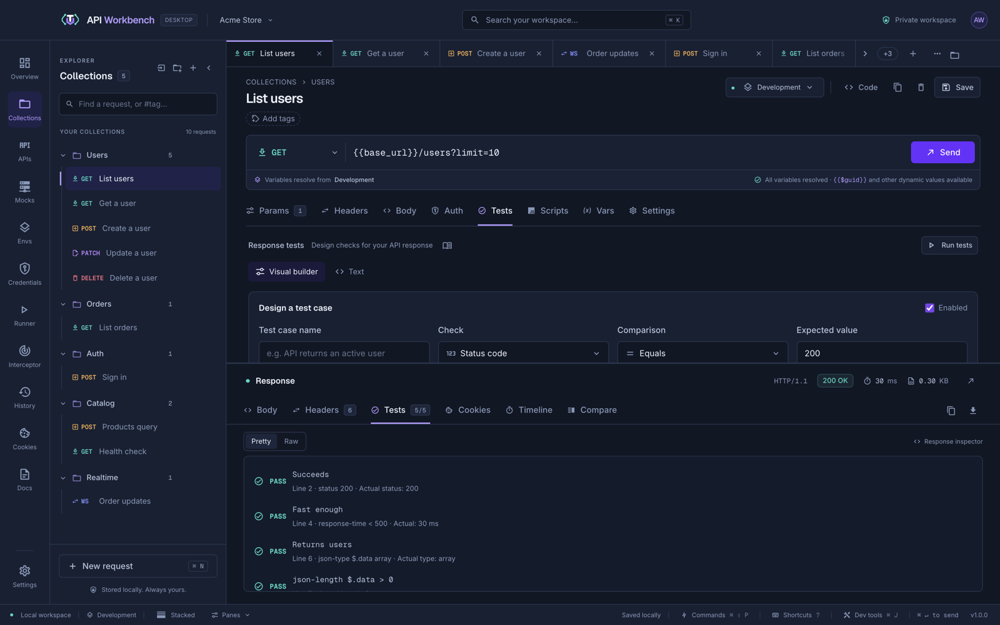

# Tests



Tests run every time you send a request, and in [collection runs](runner.md). Write one assertion per line in **Text** mode, or build named test cases in the **Visual builder** — both edit the same tests.

- **Add basic suite** adds common checks.
- **Run tests** re-checks the latest response without sending again.

## Assertions

```text
// Status, performance, and size
status 200
status between 200 299
status in 200, 201, 204
status not-in 401, 403
response-time < 3000
response-time between 50 3000
response-size <= 1048576
timing ttfb < 300
timing total between 0 1000

// Headers and cookies
header-exists content-type
header-not-exists x-powered-by
header content-type contains application/json
header etag matches /^"[\w-]+"$/
header x-request-id is-uuid
content-type application/json
cookie-exists session
cookie theme equals "dark"

// Security
certificate-days-left > 30

// Body
body-contains admin
body-not-contains error
body starts-with "{"
body ends-with "}"
body contains-ignore-case "success"
body matches /"id":\s*\d+/
body-length between 1 10000
body-not-empty

// JSON paths and typed values
json-valid
json-exists $.data[0].id
json $.data[0].role equals "admin"
json $.total >= 1
json $.total between 1 100
json $.status in ["active", "pending"]
json $.email matches /@example\.com$/i
json $.tags contains "admin"
json $.roles contains-all ["read", "write"]
json $.email is-email
json $.ids is-unique
json $.created is-date
json-type $.data array
json-length $.data > 0
json $["field.name"] equals "value"

// JSON Schema
json-schema {"type": "object", "required": ["data"]}
json-schema $.data[0] {"required": ["id", "role"]}
```

### Comparisons

| Compare     | Comparisons                                                                                                                                                                                                                                                                                          |
| ----------- | ---------------------------------------------------------------------------------------------------------------------------------------------------------------------------------------------------------------------------------------------------------------------------------------------------- |
| Numbers     | `==`, `!=`, `<`, `<=`, `>`, `>=`, and `between min max` (inclusive) — for status, response time, response size, body length, JSON length, JSON numbers, network timing (`timing <phase>`), and `certificate-days-left`                                                                               |
| Text        | `equals`, `not-equals`, `contains`, `not-contains`, `starts-with`, `not-starts-with`, `ends-with`, `not-ends-with`, `equals-ignore-case`, `contains-ignore-case`, `matches`, and `not-matches` — for headers (`header <name> …`), cookies (`cookie <name> …`), the body (`body …`), and JSON strings |
| Format      | `is-uuid`, `is-email`, `is-url`, `is-date` (a real calendar date, ISO 8601), `is-number`, `is-integer`, `is-empty`, and `is-not-empty`, with nothing after them — for headers, cookies, and JSON values; for JSON, `is-empty` also means an empty array or object, or `null`                         |
| Lists       | `status in` / `status not-in` with codes; `json <path> in` / `not-in` with a JSON array of values                                                                                                                                                                                                    |
| JSON arrays | `contains` / `not-contains` check whether an element equals a JSON value, such as `"admin"` or `{"id": 7}`; `contains-all` / `contains-any` take a JSON array of values; `is-unique`, `is-sorted`, and `is-sorted-desc` check the items' repeats and order                                           |
| Presence    | `header-exists`, `header-not-exists`, `cookie-exists`, `cookie-not-exists`, `json-exists`, and `json-not-exists`                                                                                                                                                                                     |

- Text arguments can be plain or a quoted JSON string; quote them to keep leading or trailing spaces or to use `\n`.
- Patterns are regular expressions written `/pattern/flags` (flags `i`, `m`, `s`, `u`, `v`, `d`), or a plain pattern.
- A pattern that could take minutes to match is refused, with the reason, so a test from someone else cannot hang a run: a repeated group that holds another repeat (`(a+)+`, `(\d+,)*`), a repeated group whose alternatives can match the same text (`(a|ab)*`, `(\d|x)*`), back-references (`\1`), and a repeated group holding a lookaround. Repeat once instead: `^[\d,]+$` rather than `^(\d+,)*\d+$`, `[ab]*` rather than `(a|b)*`. The same applies to `regex` captures, mock rules, a mock's **Pattern** path parameters, and JSON Schema `pattern`s.
- `body-length` counts characters; `response-size` counts bytes.
- `timing` reads a network phase in milliseconds: `total`, `preparation`, `ttfb`, `queueing`, `dns`, `tcp`, `tls`, `stalled`, `sending`, `waiting`, or `download` (see [Network timing](responses.md#network-timing)). `certificate-days-left` counts whole days until the server's certificate expires, for HTTPS.
- `cookie` checks read the cookies the response set, the last one when several share a name.
- `json-schema` validates the body, or the value at a path, against a JSON Schema object: types, `required`, `properties`, `additionalProperties`, `items`, `enum`, `const`, lengths, ranges, `pattern`, `format`, `allOf` / `anyOf` / `oneOf`, and local `$ref`s. A failure lists what is wrong and where.
- Numeric checks accept `==`, `!=`, `<`, `<=`, `>`, and `>=`.
- JSON equality is strictly typed — `"1"` and `1` differ — and objects compare structurally.
- Paths support dot notation, array indexes, and double-quoted bracket keys.
- Lines starting with `//` or `#` are comments. Name a test case with `// @case "Name"` on the line before it, and disable one with `// @disabled`.

> [!NOTE]
> Assertions that cannot be parsed fail with an explanation, so a typo never passes silently. For checks that need logic, write a post-response [script](scripts.md) with `aw.test`; its results appear with these.

## Results

Each result shows pass or fail, the line it came from, and the actual value, so a failure explains itself. Right-click a result to copy its assertion, or to capture the value it checks into a variable (see [Capture values from responses](variables.md#capture-values-from-responses)). **Raw** shows the same results as JSON with totals.

## Chain requests

Tests check a response; **captures** carry values from it into later requests. See [Capture values from responses](variables.md#capture-values-from-responses) and the guide [Chain requests with captured variables](guides/chain-requests.md).
