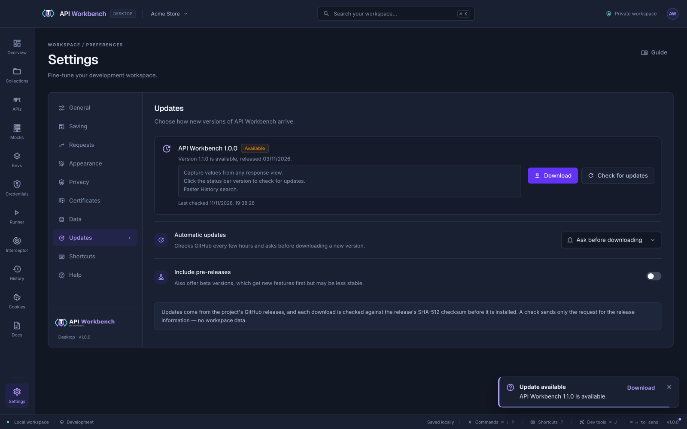
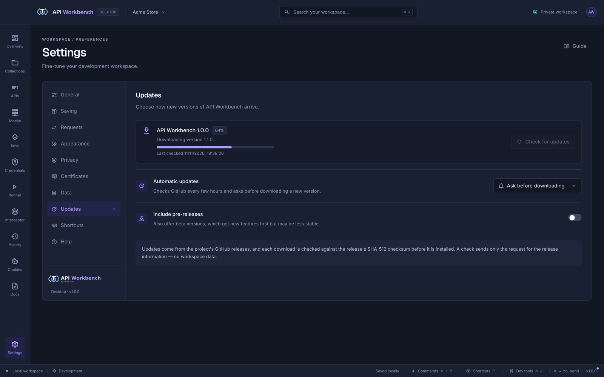
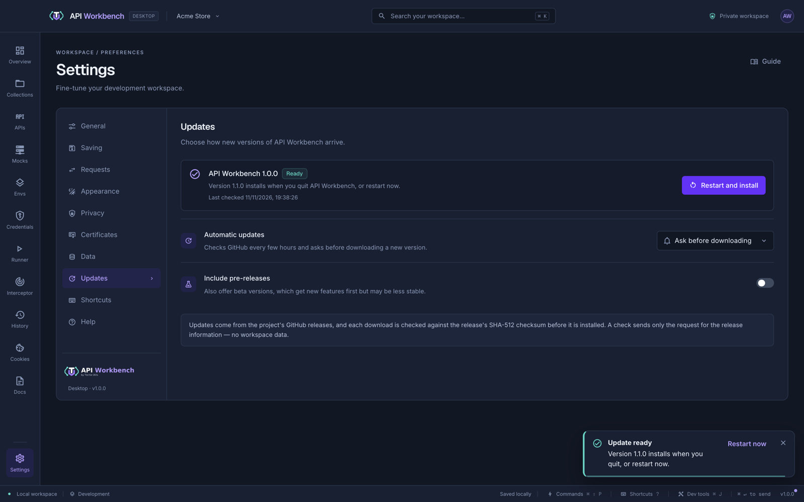

# Updates

API Workbench keeps itself up to date from the project's [GitHub releases](https://github.com/techieutils/api-workbench/releases). By default it checks on its own and asks before downloading anything. You choose how it works in **Settings → Updates**.

## Choose how updates arrive

Open **Settings → Updates** and pick **Automatic updates**. The change applies as soon as you pick it; there is nothing to save.

| Automatic updates                      | Checks                                    | Downloads               | Installs                          |
| -------------------------------------- | ----------------------------------------- | ----------------------- | --------------------------------- |
| **Ask before downloading** (default)   | 10 seconds after startup, then every 6 h  | When you click Download | When you quit, or **Restart now** |
| **Download and install automatically** | 10 seconds after startup, then every 6 h  | In the background       | When you quit, or **Restart now** |
| **Only when I check**                  | Only when you click **Check for updates** | When you click Download | Only with **Restart and install** |

Turn on **Include pre-releases** to also be offered beta versions. They get new features first but may be less stable. Turning it off again stops new betas from being offered; it does not move you back from a beta you already have — see [Go back to an earlier version](#go-back-to-an-earlier-version).

## Check for an update

There are three ways to check:

- **Click the version number** at the right of the status bar. It checks, then tells you whether you are up to date or offers the new version.
- Click **Check for updates** in **Settings → Updates**.
- Run **Check for updates** from the command palette (<kbd>⌘/Ctrl</kbd>+<kbd>Shift</kbd>+<kbd>P</kbd>).

While a new version is waiting — found, downloading, or ready to install — a small dot shows on the status bar's version number, and the **Workspace essentials** card on the **Overview** says which version it is.

## What you see

**A new version is available.** The status card shows the version, its release date, and its release notes. Click **Download**, here or in the notice. In **Download and install automatically** mode the download starts by itself and there is no notice.

**Downloading.** A progress bar shows how far the download has got. You can keep working; nothing is installed until you quit or restart.

**Ready to install.** The update installs the next time you quit API Workbench. To install it now, click **Restart and install**, or **Restart now** in the notice; the app closes, installs the update, and opens again with your workspace as you left it.

| Badge           | Meaning                                                                                                |
| --------------- | ------------------------------------------------------------------------------------------------------ |
| **Not checked** | No check has run since the app started                                                                 |
| **Checking**    | Looking for a new version                                                                              |
| **Up to date**  | You have the latest version                                                                            |
| **Available**   | A newer version can be downloaded                                                                      |
| **64%**         | Downloading                                                                                            |
| **Ready**       | Downloaded; installs when you quit                                                                     |
| **Failed**      | The last check or download did not finish — see [Troubleshooting](#troubleshooting)                    |
| **Manual**      | This copy cannot update itself — see [Which copies update themselves](#which-copies-update-themselves) |

## Which copies update themselves

| You installed                     | Updates itself                                                                                          |
| --------------------------------- | ------------------------------------------------------------------------------------------------------- |
| macOS `.dmg` or `.pkg`            | Yes                                                                                                     |
| Windows installer (`.exe`)        | Yes                                                                                                     |
| Linux AppImage, `.deb`, or `.rpm` | Yes                                                                                                     |
| Windows portable `.exe` or `.zip` | No — download the new one from [GitHub Releases](https://github.com/techieutils/api-workbench/releases) |
| Linux `.tar.gz`                   | No — download the new archive, or switch to the AppImage, `.deb`, or `.rpm`                             |
| Run from source (`npm start`)     | No — pull the latest code and run it again                                                              |

A copy that cannot update itself shows **Manual** and says why, and **Check for updates** is hidden. You can still set **Automatic updates** and **Include pre-releases**; they take effect in installed copies that use the same [data folder](installation.md#where-your-data-is-stored).

## Privacy and security

- **What a check sends.** One request to GitHub for the latest release information, made by the app's main process. Nothing from your workspaces, history, or credentials goes with it, and there is no account, analytics, or telemetry. Choose **Only when I check** if you do not want the app to contact GitHub on its own.
- **Where updates come from.** Only this project's GitHub releases, over HTTPS.
- **How downloads are checked.** Every download is compared with the SHA-512 checksum published with the release, and is not installed if they differ. On macOS the update must also be signed by the same developer as the installed app.
- **Your data.** Updating replaces the app, not your data. Workspaces, collections, history, and the credential vault stay in the [data folder](installation.md#where-your-data-is-stored) and open in the new version.

The [security policy](../SECURITY.md) describes how security fixes are released. Only the latest version receives them, so keep updates on.

## Go back to an earlier version

Updates only move forward. To return to an earlier version — or from a beta to the latest stable release — download it from [GitHub Releases](https://github.com/techieutils/api-workbench/releases) and install it over the current one. Your data folder is kept. Then choose **Only when I check** if you do not want to be offered the newer version again right away.

## Troubleshooting

| Message                                                                 | What to do                                                                                           |
| ----------------------------------------------------------------------- | ---------------------------------------------------------------------------------------------------- |
| Could not reach GitHub to check for updates                             | Check your connection, VPN, or firewall: the app needs HTTPS access to `github.com`. Then try again. |
| No update information was found for this platform in the latest release | The newest release is still being published, or has no build for your platform yet. Try again later. |
| The update could not be verified: its signature did not match           | Nothing was installed. Download the new version from GitHub Releases and install it yourself.        |
| Updates are installed by released builds; this one was run from source  | Expected when you run `npm start`. Pull the latest code instead.                                     |
| The portable Windows build / this Linux archive cannot update itself    | Download the new version yourself, or use the installer, AppImage, `.deb`, or `.rpm`.                |

Update checks use the operating system's network settings, not the proxy in **Settings → Requests**, which applies only to the requests you send.

The update choice is saved in `updates.json` in the [data folder](installation.md#where-your-data-is-stored). Deleting it returns to **Ask before downloading** with pre-releases off.

## Related

- [Installation](installation.md) — download an installer, and where your data is stored
- [Settings](settings.md) — every other preference
- [Changelog](changelog.md) — what changed in each version
