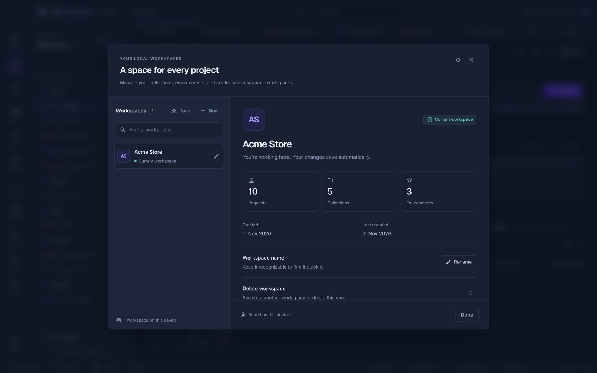

# Workspaces

A workspace is a separate space for a project: its own collections, environments, tabs, history, settings, and encrypted credential vault. Click the workspace name in the top bar to create, switch, rename, or delete workspaces.

- A new workspace starts with one blank request and a Development environment.
- Changes save automatically, and before switching; [Settings → Saving](settings.md#saving) can save after a pause instead, or only when you press <kbd>⌘ S</kbd>. Finish running requests and close live connections first.
- **Save in** chooses where a new workspace is kept: the default folder from [Settings → Saving](settings.md#saving), the app's data folder, or a folder you choose. The workspace's details show where it is.
- To delete a workspace, switch to another one first. Deleting removes its requests, settings, history, and credentials. A workspace saved in a folder of your own is removed from the list instead, and its files stay in that folder.
- To work on a workspace with others, share it in a folder your team can reach. See [Team workspaces](team-workspaces.md).

## Where your data lives

Everything is stored locally: in the app's user data folder, or, for workspaces created with a [storage folder](settings.md#saving), in that workspace's own folder ([team workspaces](team-workspaces.md) live in the folder you share). Encrypted credential files are always in the app's user data folder. Each workspace has a workspace file, a `collections` folder with a directory per collection and folder and a YAML file per request, and a separate encrypted credential file. Nothing is synced to a server. See [where your data is stored](installation.md#where-your-data-is-stored).

- Request bodies, environments, inline auth fields, and cookies are stored as plain text in the workspace and request files. Use the [credential vault](credentials.md) for secrets.
- Saving is atomic, and a workspace that cannot be read is never overwritten.
